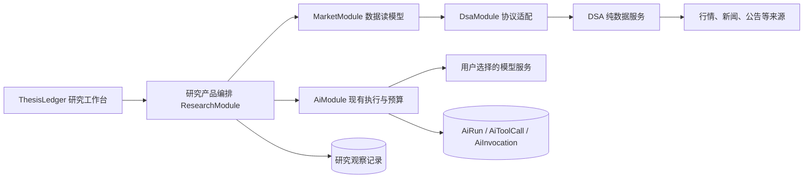

# 数据供给与研究能力增强方案

> 任务标识：`research-evidence-evolution`；首次日期：2026-10-18。
> 实施进度、当前门禁及运行记录统一由[现行 Task](../tasks/2026-10-18-research-evidence-evolution.md)维护；本规格保存稳定合同，不以早期交付摘要覆盖后续验收或授权。
> [实施顺序与任务](../tasks/2026-10-18-research-evidence-evolution.md) · [DSA 纯数据服务规格](../../../daily-stock-analysis/docs/specs/2026-10-18-data-only-service.md) · [上游能力核查](../reviews/2026-10-18-dsa-upstream-capability-reference.md)

## 1. 确定的产品方向

**DSA 只承担数据供给；ThesisLedger 负责 AI 执行、研究编排、报告、历史、复盘和通知。** 直接接入 DSA 的内容限于正式数据与控制合同。上游 AI 产品的参考价值转化为 ThesisLedger 现有功能的增强。

用户同时要求模拟/实际账户使用全局开关。研究创建、历史查询、比较与复盘必须服从统一模式，并将任务创建时的范围冻结下来；全局开关本身继续由[全站 UI Task 的 R01](../tasks/2026-09-08-ui-interaction-consistency.md)维护，本文不另建第二套模式状态。

这次分成两组规格，是因为“DSA 独立数据运行”与“ThesisLedger 研究产品增强”可以分别交付。数据合同与正向消费门禁连接两组，具体代码和进度各有唯一所有者。

### OpenRouter 显式兼容配置与 G3 验收边界

- Provider 保存输入允许显式选择 `compatibilityExtensionProfile=openrouter-v1`，仅适用于 Chat Completions 的 `compatible` 实现；省略时保留原扩展，不按名称或域名推断。
- 待保存扩展必须同时参与用途验证、配置指纹及最终持久化；旧配置的验证记录不能充当新扩展的证明。仅验证原有已启用的研究和策略编写分析，其他用途启停、模型、默认与数据来源路由保持。
- 验证授权可选择 `stopOnFirstFailure=true`，首次失败立即终止整次验证，不切换输出方式，也不继续后续用途；既有未选择该约束的流程保持兼容。
- G3 请求诊断在 SDK 完成参数转换、调用 HTTP `fetch` 的边界采集；只保存首个请求的白名单参数、UTF-8 长度和摘要，以及发送尝试／省略计数。该边界证明传入传输层的参数，不代表服务端已收到。单份最多 1 KiB，禁止 headers、URL／query、消息／Prompt、Schema 原文、工具原文及凭据进入诊断；失败随错误保留，成功随请求事实保留，旧记录可缺省。
- HTTP 请求诊断不改变请求体、认证、重试、用量或业务结果；运行诊断 8 KiB、失败诊断 12 KiB 边界保持。先验证本地最终请求及生产 JSON 账本往返，再在剩余最多 15 次、总费用 0 元范围继续 G3，首次失败即停，验后 V2=false。
- 本次两条用途验证与后续 G3 共用剩余最多 19 次调用、总费用 0 元；用途验证全部通过后才能保存新配置并继续 G3，任何失败即停且不自动重试。G3 临时开启 V2 写入，验后恢复关闭，保留原数据、来源启停与路由。

### 研究用途显式推理开关与受控复验

- 研究 executionRoutes 增加可选 reasoningEnabled，限制为 OpenRouter 显式兼容配置下的 research-generation-v2；省略时保留旧行为和旧指纹。显式值参与用途验证、保存、运行配置指纹和研究路由冻结，SDK 最终映射为 reasoning.enabled，不按 Provider 名称猜测。
- 同一研究用途开关变化使其旧证明失效；其他用途指纹与证明、来源启停及数据路由保持。研究默认仅在用户明确授权切换、候选零费用定价及完整 V2 用途验证通过后，经正式修订保护入口变更；不得为绕过验收静默切换。实际派发必须核对冻结开关与当前配置一致，旧记录可缺省，历史结果不重写。
- 新授权范围为本地验证和官方更新后最多两次零费用调用：研究用途复验一次、正式 G3 一次，共用当前剩余十二次。首次失败终止、不自动重试；仅正式 G3 临时开启 V2，验后恢复关闭。
- 用户已确认修正前置：用途探针透传准确合同，研究 V2 使用真实 V2 Schema／消息，旧未指定合同的调用保持兼容；仅 stopOnFirstFailure=true 时允许显式授权较小次数，范围满足 pending 用途数不超过授权次数且授权次数不超过原计划。原计划指纹必须匹配，执行预算采用显式授权值；未启用该约束的流程保持原严格比较，不调整原 auto／模式／启停。

### G3 HTTP 响应诊断与本地验证

- G3-RSP1：仅研究 V2 在实际 `fetch` 响应进入 SDK 前观察首个响应的状态码、内容类型分类、接收字节数和原始 SSE 帧统计。收到 HTTP 响应与 SDK 识别出模型帧分别记录；无响应、未读完和诊断截断不得推断为上游正常结束。
- G3-RSP2：错误仅保留数值状态／错误码、固定分类、字符数、摘要和遮蔽全部自由文本的结构预览；允许对有界 `error.metadata.raw` 做同样归一化。禁止保存 headers、URL／query、原始错误消息、模型正文／推理、Prompt 或凭据。每帧及非 SSE 响应最多暂存 8 KiB 字符，溢出后明确标记并继续透明传递响应。
- G3-RSP3：可选响应诊断随既有失败运行诊断保存，单份最多 2 KiB；请求诊断 1 KiB、运行诊断 8 KiB、失败诊断 12 KiB 原边界保持。旧记录无需新增字段或重写，不改变请求、认证、响应字节、SDK 解析、错误映射、重试和结算语义。
- G3-RSP4：本轮仅本地受控 HTTP／SSE、错误合同与 JSON 往返验证；不部署、不新增模型调用，剩余 8 次冻结，默认 `openrouter/free`、推理行为、原数据／来源启停／20 条路由及 V2 关闭状态保持。真实响应留存与 G3 正向验收仍由后续获准的目标门禁承担。
- G3-RSP5：D20 故障特征对照保留当前真实 SDK、兼容层与应用适配器，只在 HTTP 边界提供合成固定响应；所有未匹配请求立即失败，禁止访问外网或运行中的业务 API。分别验证 HTTP 拒绝、标准 SSE 错误、SSE JSON 语法失败、SDK 事件合同失败、响应前拒绝及响应体中断。合成匹配只证明路径可解释现象；只有固定反例证明本地缺陷，且同版本修复前／后及隔离撤补丁验证成立时才实施补丁。保持 RSP1～RSP4 的留存、语义与预算边界，离线完成不代收正式报告、引用／历史、发布反读及关闭保全。
- G3-RSP6：本轮允许处理 D21 部署前置：修复已核实的三条手机验收夹具跨应用引用，通过现有边界门禁；随后只读核查 capabilities 502 的请求路径／代理／目标响应及 D21 实际模块。手机夹具只拥有合成请求与公开响应合同数据，不导入 Server 业务实现或其测试工厂；保留既有验收产物及 WIP，不增加边界豁免。只读 GET、Docker 状态／文件摘要检查不包含部署、模型调用、目标配置或业务写入；历史 502 无原响应时不得把当前复验冒充历史完整溯源，剩余 8 次继续冻结。
- G3-RSP7：本轮允许通过 infra 正式入口将 D21 部署至最小 thesis-ledger 目标；依赖／结构兼容且现有容器运行时使用 sync-code.sh，预检拒绝或运行条件要求时使用 update.sh 默认保留数据路径，不绕过门禁。V2 继续关闭，不调用模型，不改变业务配置、数据或既有 WIP，不暂存／提交；余 8 次冻结。部署前后核对 Server／Worker 与实际解析的 Schema 包、capabilities、配置／挂载／业务摘要；快更只证明容器可写层更新，不证明镜像或重建持久化，也不代收真实响应与正式 G3。
- G3-RSP8：用户要求继续下一步后，允许一次新的正式 G3 请求，沿用 openrouter/free、推理默认、严格 V2、shadow 与近期变化模板；本阶段最多 1 次真实调用、总费用约束 0 元，首次失败停止新增发送，不执行额外用途验证或 Provider 直连。按正常业务重新准备并冻结本次材料，记录新的请求摘要，不修改／重放 D20。官方更新入口临时开启 V2 与单次免费策略；无论结果均经官方入口恢复关闭并核对保护。其余预算继续冻结，调用后按实际次数核减；不得把未知实际费用记为 0。
- G3-RSP9：用户要求先确认上游返回内容；优先只读寻找 D25 已有原文。原文缺失时先准备独立本地取证入口并用离线 fixture 验证，余7次保持冻结，不把该要求直接视为重新发送授权。后续单次采样需另行明确授权：复用 D25 冻结输入与同一 SDK／完整合同，在 fetch_response 边界旁路读取 response clone，保持交给 SDK 的响应字节不变；原始 assistant.content 先独立保留，再做 JSON／完整合同校验。原文只进入本地私有且 Git 忽略的取证文件，不进入业务表、共享诊断或日志；不保存 Prompt、凭据／请求头或推理原文。请求体须匹配 D25 已留摘要，最多真实 fetch1、不重试，默认／推理／max_tokens保持，V2全程关闭，不部署、不改配置或业务数据。新响应不能冒充已丢失的 D25 原响应，诊断采样不代收正式 G3。

### G3 请求链输入输出 trace

- G3-RSP10：用户进一步要求可拦截 HTTP 并把同一上游响应继续交给 SDK／业务侧，记录各节点输入输出。本轮实现正式链路的显式选中 trace：业务执行输入 → SDK 输入及最终序列化请求 → HTTP／上游响应 → SDK 输出或校验错误 → 业务结果构建与最终状态。沿用同一次物理 HTTP 请求，fetch 接缝允许真实传输与受控响应 Adapter；上游副本取证不改变交给 SDK 的响应状态、headers 或 body 字节，不新增调用或自动重试。SDK 的原输出／错误继续进入原业务和所有权／终态逻辑。
- trace 由 AI 执行模块拥有，Server 内部合同不提升到 packages。研究创建使用可选操作标记 `X-Thesis-AI-Trace: capture-v1`，已通过原身份／范围检查的新任务只保存轻量 `diagnosticTrace` 引用；响应头返回 traceId，正常请求仍按原 receipt／冻结输入合同运行。执行端按 AiRun 的 runId／owner／attempt 绑定私有 trace，恢复后的新 attempt 单独记录，保留原 attempt，不反向依赖 research／ledger／market／backtest 编排。默认不捕获，不改变 V2 写入门禁。
- 本次“各节点输入输出”允许显式 trace 在私有文件中保存必要业务材料、Prompt／请求体、模型正文和 SDK／业务输出；原共享有界诊断合同保持。凭据、认证头与 Cookie 不得写入，Provider 推理原文默认脱敏，仅保留计数／摘要。实际请求、原始正文和保存副本分别记录字节数／摘要及脱敏标记，不把格式化／脱敏副本冒充原 wire。SDK 校验失败时原始模型正文仍可独立取得，字段问题码／路径与独立合同校验事实分开记录，不把自编摘要当上游返回。
- 私有 trace 写到现有持久化数据根下的独立 AI 目录，文件／目录权限收紧；单 trace／单响应有界，超限、写入失败、取消或进程中断须显式标记 incomplete。发送前 trace 预检失败不发模型；发送后取证失败不覆盖原 SDK／业务结果，不补发。只读查看／导出须验证引用、runId 和 attempt，不提供任意路径读取；共享日志与业务表不保存原文。通过文件引用和父子节点关联查看每个节点输入输出，未执行节点明确说明跳过原因。
- 落地限制：默认私有根为 `${BACKTEST_SNAPSHOT_ROOT || cwd/var/backtest}/ai-traces`，沿用既有持久化根的物理目录，不依赖 backtest feature。每个响应最多保留2 MiB内存副本，独立 artifact 最多2 MiB，单 trace artifact 总额8 MiB，manifest最多128 KiB／64节点；文件0600，私有目录0700。HTTP原流记录实际字节摘要，落盘保存脱敏后的JSON／SSE payload与独立 `assistant-content.txt`；原SSE排版、注释和推理原文不归档。不可解析／超限／取消的副本标记incomplete，完整性与业务终态分别表示。SDK消费的状态、headers和字节流保持原值；SDK结束后取消未消费流，取证不另建继续运行的clone。
- 输入／输出节点由 `business.execution`、`sdk.generate`、`http.request`、`upstream.response`、`business.result`、`business.persistence` 与 `business.final_state` 组成；根节点输出采用按run／owner／attempt实际读回的业务状态，CAS拒绝和未观测终态保留原值。`nativeFetches` 表示实际transport调用次数；每个SDK requestId最多一次，既有策略允许的后继请求沿用不同requestId与原预算。SDK异常链与事后独立Schema检查分别标记来源，字段问题保留码／路径／截断数量；共享日志只输出索引、状态和调用次数。
- 未结束的manifest在反读时按incomplete处理，保留running／未结束时间事实，不回写原文件，也不直接推断进程已中断；实际业务终态只来自原所有权条件下的状态反读。
- D27阶段完成代码、受控 HTTP／SDK／业务闭环与包级／仓库门禁，该阶段不部署、不调用真实模型。D28按后续用户授权进行门禁修复、正式部署与无模型运行态核对；剩余7次仍冻结，不改目标配置／业务数据，不暂存／提交。真实选中任务的私有卷捕获／重建持久化与单次 OpenRouter trace仍另列验收，须独立授权，不以离线 trace 代收 G3。

### G3 trace 部署前的源码门禁范围

- G3-RSP11：工作区 lint 的源码清单使用 Git 已跟踪文件与未被现有 Git ignore 排除的未跟踪文件的并集，再应用现有 ESLint 文件规则；保留未提交源码检查，已跟踪但后来被 Git ignore 覆盖的源码仍纳入候选。文件名按NUL分隔处理，删除文件不作为现存输入。Git清单读取失败须停止，不回退到包含验收包的目录扫描。
- ESLint 按该精确文件清单执行，不能在分组后再次展开整个目录。现有 `apps/mobile/release/`、`apps/desktop/release/` 和 `.recovery-artifacts/` 属于已声明的生成／恢复产物范围，保留原位和内容；不新增ignore、不关闭类型／边界规则、不扩大project service默认许可、不调整复杂度阈值。真实源码与未提交WIP中的违规仍必须失败。
- 本轮用户已授权通过门禁后经infra正式入口部署trace。部署前核对兼容性与业务／配置保护基线，选择最小 `thesis-ledger` 目标；只在兼容性通过、目标正在运行时使用 `sync-code.sh`，预检拒绝则按原约束使用 `update.sh`。Server／Worker及实际Schema包须独立核对，正常capabilities仍为关闭；不调用模型、不启用V2，剩余7次冻结。代码快更只证明容器可写层，不能声称镜像或重建后的trace已验。

### D29 真实 trace 与重建验收授权

- G3-RSP12：用户要求验收真实模型trace和重建持久化。本阶段只解除7次冻结中的1次，使用原 `openrouter/free`、原推理／严格V2合同、同一shadow对象及近期变化模板；新提交ID与显式trace header走正式业务入口，最多1次实际模型派发、零费用路由、不自动重试，失败后停止新增发送。其余6次继续冻结；若未实际派发，不核减调用。可用性／失败事实均按真实返回记录，不用新响应回填D25旧正文。
- 通过infra最小正式update将trace固化进镜像；为正式提交临时开启V2及单次零费用策略，终态后从同一入口恢复原配置。关闭与重建复用已验完整镜像ID，不因验收阶段重复构建；保留锁、空间、数据库check及卷保护。两面实际模块与Schema、调用次数和所有权、原文／SDK／业务节点I/O、权限、关闭状态及数据保全须独立核对。
- 重建前后对同一trace的manifest和全部私有文件逐字节摘要核对，两消费者必须从原共享卷反读；同时保持旧业务行／配置／来源／路由及WIP，允许的业务新增仅本次研究及其工具审计。凭据、Cookie、认证头和推理原文仍不落入共享日志或公开证据。真实trace捕获／持久化验收与报告成功／引用验收分开，不以生成失败掩盖trace缺口，也不以trace通过代收G3业务成功。
- G3-RSP13：D29在TLS建立前失败后，用户明确另授1次补验，由G3-D30承接；冻结余6次中只解除1次，其余5次冻结。复用D29已验镜像和未变执行代码，临时开启／关闭均走infra正式镜像复用入口；使用新提交及trace，不重发旧提交、不自动重试。原free／零费用上限／推理默认／严格V2合同及数据保护条件继续适用，成功或失败后均关闭V2并完成同镜像重建反读。D29原失败事实不改写。
- G3-RSP14：D30之后的参数归因只读核对原wire、SDK输入与映射、响应结束字段、官方默认／端点能力和离线Schema，不新增模型请求或部署，不修改原配置／业务数据。明确区分本地已发参数、OpenRouter声明的能力、Nvidia文档中的默认及无法读取的实际转发／内部终止原因；不能仅凭推理token占比认定耗尽20000上限，或把“支持结构化输出”代作该次严格约束已生效的证据。余5次保持冻结。
- G3-RSP15：D31确认的native JSON Schema／业务Zod语义差异需独立治理：derived numeric claim的operands必须恰好2项，输出Schema须保留这一约束，不能通过放宽业务Zod消除差异。后续离线验收至少覆盖长度0／1／2／3和完整既有样例；本轮只登记待办，不能把该差异当作D30两字符或D25未知字段错误的已证实根因。
- G3-RSP16：用户明确授权1次零费用单请求对照，固定D30实际canonical Nvidia免费模型，仅本次发送reasoning.enabled=false；原stop缺省、max_tokens=20000及response_format必须保持，余4次冻结、失败即停。为保持默认配置及业务数据，使用D30冻结的messages／Schema和同版本SDK作独立诊断，不创建新业务报告、不启用V2；发出前对整个请求体做差异门禁，仅允许model固定和reasoning关闭两项语义变化。凭据仅通过原数据库密文和现有解密函数在内存读取，不轮换、不落盘；Docker仅只读检查，诊断trace保存宿主私有目录。结果须分别记录请求控制是否生效、实际reasoning用量、JSON／Schema结果和对原因的支持程度，不能把单次对照或诊断输出代收G3正式业务报告。结束核对V2关闭、默认配置／原数据／WIP保持，不stage／commit。
- RSP16执行回执：D33仅派发1次，上游生成记录确认指定Nvidia模型、推理0 token、费用0和stop；本地SDK在30秒首语义chunk超时后取消读取，trace为incomplete，现存9份产物完整性通过。用户后补同generation的控制台完整正文，离线JSON及当次JSON Schema通过，业务Zod因nextSteps[1].claimId引用条件而非断言拒绝，同版本离线SDK返回schema_invalid，新增外部调用0；原在线超时事实和trace不回写。一次完整JSON支持两字符现象本次未重现，仍不能确证D30根因或代收报告；V2始终关闭、配置／业务数据保持、余4次冻结，不自动补发，详见[D33回执](../tasks/evidence/2026-10-25-g3-reasoning-off-control.md)。

- G3-RSP17：用户授权实施固定Provider／模型的自适应超时与重试，稳定合同及本地实现由[AI自适应执行规格](2026-10-25-ai-adaptive-execution.md)所有；本轮不新增真实调用或部署授权，V2关闭、余4次冻结。D31／D32及真实报告义务保持，不能以策略实现或离线trace代收原G3验收。
- G3-RSP18：用户随后要求“再次验证G3”，由D35承接新的单次正式验收：从余4次中预留1次零费用请求，其余3次冻结，失败即停、无补发。沿用默认OpenRouter/free和原reasoning／严格V2合同；经infra最小thesis-ledger入口部署当前已验源码，临时开启V2及maxAiCalls=1／maxCost=0策略，终态后关闭并恢复原环境。环境切换需要重建消费者，故用update固化新源码后复用同一新镜像关闭；DEV_DATABASE_MODE=check，不改默认配置、Schema或原业务行。两消费者／实际Schema及自适应模块、真实请求trace／预算、报告消费与关闭后持久化分别验收；不stage／commit，未实际派发不核减额度。
- G3-RSP19：用户指出OpenRouter控制台未见请求并要求“再试一次”，由D36承接另一次独立授权，保留D35实际HTTP404及generation ID，不因控制台未列出而删除其派发事实。从余3次中预留1次、其余2次冻结；仍沿用默认OpenRouter/free／原reasoning／严格V2，maxAiCalls=1／maxCost=0，失败或未知即停，不补发。先核对目标Key与用户提供控制台记录的摘要一致性，不输出凭据；确认53项执行输入、目标双角色和已验镜像未变后，经infra update thesis-ledger复用同一镜像开启与关闭临时策略，不重新构建。保留原数据／配置／验收包／WIP，DEV_DATABASE_MODE=check，不stage／commit；供应商用量／实际费用必须以本次真实证据核对，不能由预算上限或控制台缺项推断。

### D41：2020-12 候选与条件迁移

- G3-RSP20：用户于2026-10-27授权先试迁JSON Schema 2020-12，再验证Qwen和GLM，仅当两者均成功时迁入当前应用。此为有条件的通用序列化迁移，不是所有Provider已兼容2020-12的声明。候选先保存于隔离私有验收目录，主工作区业务Zod、历史数据和运行默认值保持；不得为避免tuple方言差异而更换操作数字段、删除约束、改变业务结果形状或新增品牌专属Server适配。
- 候选位于AI接入层，负责native_schema的wire Schema转换和原Zod校验委托；json_mode／json_validated行为保持。2020-12只替换传输表示，固定tuple必须用prefixItems及等价长度约束保留恰好两项；其他静态约束、严格对象、默认值和转换行为按原输入语义验证。自定义引用／数值规则继续由原Zod及业务验证承担，不宣称JSON Schema能独自表达全部细化规则。
- 本轮最多新增2次真实请求，固定现有Cloudflare Qwen3.8-27B与GLM-4.7-Flash各1次，顺序Qwen通过后再GLM；复用D40冻结材料、严格结构化模式和网关正文日志，输出token上限仍省略，不显式改stop或reasoning。沿用用户确认的Workers Free零费用边界，SDK重试0；任一失败即停止其余派发和推广，未用授权继续冻结，不换模型或自动简化Schema补测。
- 候选成功同时要求本地合同检查、实际HTTP／日志／SDK完整响应、合法研究对象及冻结证据引用／数值检查通过；HTTP200或可解析JSON不单独算成功。两模型及本地回归均通过后，才按实际候选源码落入通用输出层，并使相关native_schema接入证明反映新的序列化版本；无关模式证明保持。
- 不启用V2或Cloudflare Provider，不切应用默认研究模型，不修改数据库、Provider配置、凭据、网关设置或业务数据，不stage／commit。条件迁移落入源码与目标运行态部署是独立层次；本轮宿主SDK验证不代收正式G3报告／历史／Web或容器部署验收。

| 验收编号 | 必须证明的事实 | 实现与验证所有权 |
| --- | --- | --- |
| G3-SC1 | 真实候选wire为2020-12，tuple不再使用数组items，固定两操作数长度不丢失 | AI通用序列化候选、SDK受控出站 |
| G3-SC2 | 长度0／1／2／3、完整研究样例、严格对象及原Zod细化规则保持；现有生成合同可转换 | 候选定向测试、原生成合同与SDK输出测试 |
| G3-SC3 | Qwen和GLM各最多1次，合法研究对象及冻结业务校验成功，原文／用量／日志关联完整 | 独立真实请求、私有trace／网关日志 |
| G3-SC4 | 仅SC1～SC3均通过才推广相同候选源码，相关就绪证明可区分新序列化版本 | 通用输出层及native_schema就绪指纹 |
| G3-SC5 | 数据／默认值／V2关闭／WIP与授权预算保持；失败不推广、不补发 | 调用前后保护反读与条件门禁 |

2026-10-27候选结果：SC1／SC2本地通过，SC3未通过，SC4未执行；Qwen的400方言拒绝未再出现，但约300秒超时、网关499，无合法研究对象，trace及网关正文截断。GLM未派发、1次冻结，应用源码／就绪版本不变，SC5保护通过。详见[D41回执](../tasks/evidence/2026-10-27-g3-schema-2020-candidate.md)；不得把单模型HTTP200解释为迁移条件达成。

## 2. 哪些接 DSA，哪些完善现有功能

排期统一采用[全局优先级](../tasks/README.md#priority-policy)：本方案 P1 基础/最小链排在现行正确性修复之后；这不是独立标的新闻或 D0/T0 盘点的全局阻塞条件，也不放宽原生产/消费合同。

| 能力 | 实施方式与归属 | 优先级及交付判断 |
| --- | --- | --- |
| 行情、K 线、日历、财务/参考资料、公告、公司行动、汇率、确定性指标 | 继续通过 `MarketModule → DsaModule → V3` 消费；保持现有精确来源与准入，不重建数据平台 | P1 基础保持兼容；兼容性仍为硬门槛，已有来源的开放验收由原 Task 维护 |
| 新闻检索、标题/原文摘要、出处和时间 | 在 DSA 抽取检索实现并新增正式新闻能力；ThesisLedger 提供标准读模型与冻结证据 | P1 首条新增数据路径；当前不能把 `getNews` 定义算成实际接入 |
| 来源可用性、质量、更新时间 | DSA 提供事实和诊断；ThesisLedger 现有数据管理/研究界面解释这些信息 | P1 数据合同与报告质量；复用现有目录和控制配置 |
| 股票 AI 分析、反证与风险解释、新闻摘要/情绪推断 | 使用 ThesisLedger 的 AI SDK、模型用途、预算、审计和任务生命周期 | P1；原始新闻与 AI 推断分别标识 |
| 结构化报告、失效条件、观察期限、下一步 | 扩展现有 `ResearchResult`、冻结证据和报告详情 | P1；写入时固定完整产物，旧报告继续可读 |
| 工具调用轨迹与质量评估 | 基于 `AiToolCall`、`AiInvocation`、执行摘要完善离线评估 | P1；先解决可观测与确定性失败，再评估多阶段收益 |
| 报告历史与变化追踪 | 完善现有研究列表、详情和只读比较 | P2；区分结论、证据、数据来源和模型配置变化 |
| 研究结论到期复核 | 在研究产品内记录观察窗口与结果；交易复盘继续由 Journal 负责 | P2；缺数据、未到期、样本不足均有明确状态 |
| 研究对象确认与下一步提示 | 服务端验证/冻结对象；工作台复用统一状态模型与全局模式 | P1 对象固定，P2 变化/复核入口；不扩展成另一套 Chat 客户端 |
| 风险暴露与质量展示 | 保留 ThesisLedger Risk/Portfolio 的计算和展示所有权，按原风险/UI Task 补既有缺口 | 复用现有任务，不移植 DSA 组合、告警和资产账本 |
| 多 Agent/多阶段编排 | 在现有 AI 执行框架内做有预算的对照评估，通过后再激活阶段化执行 | P3 条件范围；默认仍是一条受控研究链 |
| ETF 轮动、额外宏观工具、新数据来源 | ETF 方法可作为策略研究资料；宏观和其他来源按统一数据能力评估 | 本次不承诺新策略或新来源；不会因清理 DSA 自动启用 |
| 用户通知 | 继续使用 ThesisLedger `NotificationsModule` 和已有渠道设置 | 本次保持既有行为；研究生成不隐式发送消息 |

### 2.1 收藏项目的实现对照边界

本方案补充对原 14 个收藏项目的逐项实现核查；`hello245m/free-stockdb` 按用户要求明确排除，不安排接入、适配、验证或依赖。每项具体参考点、已完成的固定版本源码对照、保留的外部未知与本地基线修正统一见[实现对照清单](../reviews/2026-10-18-starred-project-implementation-coverage.md)，由 T0R 承接，不能把功能推荐等同于已完成源码审查。

核查须比较“上游实际函数/测试 → 本地合同/调用方 → 最小反例 → 处理决定”，不按 README、类名、SDK 依赖或 Star 数判断成熟度。拟采用的部分先固定上游提交并核对许可证；数据 SDK、聚合项目、回测框架和 AI 产品不统一算作独立数据供应商。

研究假设与引用、数据时间/质量、实验谱系、指标预热、共同预算与失败统计中符合本方案的部分，归入既有合同和叶任务；Portfolio/Performance/Risk 的现行缺陷先交其领域，不借此重写账户或回测。已有本地修复及原验收证据优先复用，不根据落后的远端代码重开任务。未形成修复叶的发现由 T0R 明确承接，不悄悄丢进 TODO，也不把所有缺陷设为独立标的新闻研究的前置。

财务/估值、基金穿透、SEC、指数/行业等仍是待对照的能力候选。只有产品价值、实际缺口、生产/消费合同及权限边界明确后，才单独修订对应 Spec/Task；本轮不自动承诺全量接入。通用分钟、全历史/严格 PIT、券商交易与大型训练框架不因参考核查恢复已取消或未授权范围。

客户端与原生分析产品的移除范围、数据留存和部署变化由 [DSA 规格](../../../daily-stock-analysis/docs/specs/2026-10-18-data-only-service.md)统一定义。

两组可以分别验收：DSA 原有数据服务的收敛不等待新闻 V3 开发或模型可用；新增新闻只在生产者/消费者合同和来源准入就绪后启用。当前 FX 仍经过 DSA 原生组合服务与缓存，属于明确的删除前置，不能随原生组合产品移除。具体修正依据见[方案复核记录](../reviews/2026-10-18-dsa-research-plan-review.md)。

## 3. 立项基线与本地实施事实

下表保留 2026-10-18 立项核查基线；本轮复核开始时主仓已有 376 条、DSA 38 条、infra 23 条未提交路径（含已有规划文档）。这些是当时清单数量，不代表本轮变更。实施前必须重新核对，保留既有工作。

| 立项时能力 | 源码入口与本方案如何复用 |
| --- | --- |
| 数据访问与来源治理 | `apps/server/src/market/market.module.ts` 依赖 `DsaModule`、`QualityModule`；`integration/dsa/dsa.client.ts` 和 `dsa-data-capability-reader-v3.ts` 消费 V3 |
| AI 执行 | `ai/ai-research.executor.ts`、`ai-research-sdk-execution.ts`、`ai-sdk-generation.adapter.ts` 已有执行、模型调用、费用与终态链 |
| 冻结材料 | `ai/ai-frozen-research.ts` 已支持服务端冻结证据；Journal 已有消费。继续沿用，不引入第二套模型引擎 |
| 报告与存储 | `packages/schemas/src/research.ts` 的 V1 包含结论、引用、风险、未知项等；`AiRun.result` 已持久化，`AiToolCall` 保存审计 |
| 新闻缺口 | 立项时 `tool-factory.ts` 定义 `getNews`，但 `AiResearchExecutor.tools()` 只装配组合/持仓/风险和 Journal；当时已核到的 DSA V3 客户端没有新闻读取入口 |
| 对象范围 | 立项时研究输入支持 `portfolio/account/position/strategy`；持仓研究要求账户。独立标的研究需要显式合同，不能伪装成虚构持仓 |
| 模块方向 | Journal 消费 Ai；Ai 不得反向依赖 Journal。DSA 适配器不得反向依赖 Market；跨模块调整须同步 `scripts/check-boundaries.mjs` |

截至 2026-10-19，本地源码已落地 `ResearchModule`、V2 冻结提交/结果、Market 新闻读取、独立标的范围、授权历史读取、确定性比较、独立观察版本及按需复核接口和 Desktop 消费。DSA 已完成纯数据源码与旧产品退役的本地交付，T15a 受控离线驱动已交付；各自的实源、正式镜像、目标升级/恢复和真实模型门禁仍按 Task 保持未完成状态。

[研究工作台](../tasks/2026-08-25-ai-research-workbench.md)、[AI SDK](../tasks/2026-09-19-vercel-ai-sdk-integration.md)和[AI 配置](../tasks/2026-09-21-ai-provider-model-usage-configuration.md)仍有真实业务门禁。当前真实生成处于既有停止边界，本规划不恢复额度、不切模型、不触发探针；后续实源/模型验收需遵守这些权威任务的接续条件。

## 4. 目标模块与数据路径

新增 `ResearchModule` 只承接研究产品的对象解析、证据准备、历史比较与到期复核，继续使用现有研究工作台。其接口为“准备并提交研究、读取产物、比较产物、复核产物”，隐藏事实汇聚与质量判断。它有明确业务职责，不是 DSA 原生分析 API 的转发层。

依赖为 `Research → Market/Ai`、`Market → Dsa`。Ai 继续提供执行和冻结材料消费接口，不能 import Research 或 Journal；Market、DSA 适配器不能依赖研究产物或客户端。报告的共享序列化合同放在 `packages/schemas`；来源特有 DTO 留在 DSA 适配层。现有其他 AI 用途不随此迁移重写。

`AiRun` 继续是一次模型研究执行的状态事实源，复用 `queued/running/succeeded/failed/cancelled`、attempt、租约、取消和费用结算。Research 通过 Ai 的提交/读取接口消费产物，不直接改写执行终态或结果；自己只保存后续观察记录，不维护平行的运行状态表。

## 5. 研究提交与数据合同

### 5.1 对象、模式与幂等

新增独立标的范围 `instrument`，服务端通过现有标的目录解析稳定标识、市场、证券类型和币种；保持其他四种范围的约束。新增报告固定 `scopeSnapshot`，包含 `mode`、范围、实际涉及的账户/组合/策略版本、规范标的以及确认时点。

全局模式和用户选择属于服务端校验输入，模型无权改变。账户与模式不匹配时拒绝；标的研究默认只用公开数据，不隐式附带账户持仓。DSA 只收到公开标的与数据窗口。

每次创建使用客户端提交标识和服务端输入摘要。摘要绑定规范化用户输入、模式、对象及显式选择的研究设置版本，不把本次重新抓取的数据内容作为重复提交判断依据。相同标识/相同摘要返回原任务；相同标识/不同摘要返回冲突。查重与找回同样先校验调用方和原任务权限，不能仅持有提交标识就读取他人/其他范围结果。新增可空唯一提交标识等必要持久化字段，旧记录保持原值；不通过重复插入再补偿来防止重复计费。

T4 将提交身份固定为“已验证身份标识 + 提交标识”。身份来自现有 `IdentityGuard/CurrentIdentity`，本地工作区使用现有固定身份；不接收请求体中的 owner，不为旧报告补填归属。AiRun 增加可空的身份、提交标识、输入摘要和版本化范围快照；四项同时为空表示旧记录，同时存在表示新提交，数据库使用成对唯一约束。输入摘要使用规范化问题、模式、对象、模板和显式设置修订，不包含新抓取的内容、确认时点或提交标识本身。

提交仓储要求调用方提供必需的当前选择/原范围权限检查，先检查当前选择，再在身份范围内查重，并在返回原任务前检查其已保存快照。新建在现有 Provider 配置事务围栏内完成，只有确认为新提交时才构建执行配置；快照、原冻结包和任务一次写入。仓储本身不注册 HTTP 或触发执行，T5/T6 负责以已验证身份接线及默认关闭的 V2 写入控制。

已有报告只使用自身保存的范围。缺少可信模式快照的历史记录显示“历史范围未记录”，不能根据当前账户或全局开关推断为实际账户。默认模式列表不把这些记录混入；在明确的历史兼容入口可按原权限读取。

T7 的只读入口为 `GET /research/reports`、`/:id` 和 `/:id/evidence/:referenceId`。正常读取显式使用 `view=scoped`、`mode`，可按规范对象筛选；历史兼容显式使用 `view=legacy`，不接收模式。三个入口使用相同身份与范围权限，分页游标绑定查询范围。V2 以冻结内容、任务身份、结果与实际引用审计交叉核验；损坏产物保持不可用，不从当前来源修补。旧 V1 正文在引用归属缺失时可按待核验展示，引用明细只返回已确认属于该任务的审计事实。旧通用任务入口不提供带 V2 提交身份的报告或引用，防止绕过范围检查。

T7 的模型核对区分请求模型与实际模型：任务的 `provider/model` 保留执行时的请求路由，结果的 `model.modelId` 保留 SDK 解析的实际模型。两者名称不同不能单独证明报告损坏。只有同 Provider、完整有效的 `research-generation-v2` SDK 审计、当前执行 attempt 内已派发并成功完成且结构已接受的请求，以及该请求预留的 `provider/model` 与任务请求路由一致时，才允许读取实际模型名称不同的结果。缺失／不完整／跨 attempt 或请求路由不匹配的审计仍拒绝；冻结范围、设置修订、数值证据、引用归属及审计绑定检查保持。请求模型和实际模型原本相同的既有结果保持原兼容路径，不为反读重写报告或调用模型。

### 5.2 证据准备

新闻生产语义以 [DSA 新闻合同](../../../daily-stock-analysis/docs/specs/2026-10-18-data-only-service.md#42-新闻数据合同)为准。ThesisLedger 新增对应 Zod/客户端合同与 `MarketNewsReader`，能力不可用时返回明确质量和原因；不由 AI 层直接访问搜索 SDK。

协议固定为 Data V3 的 `news-search-v1`，消费侧使用同版共享样例。Dsa 层核对请求关联、来源条目与独立证据分组、原始时间、覆盖计数和错误；只进行一次有界数据请求，不因新闻能力缺失调用原生分析接口。共享序列化可以跨运行时使用，Node 加密核验留在 Dsa 协议适配层。

Market 的新闻入口为 `POST /api/market-data/news`，只接受规范证券、发布时间窗口、条数、游标与请求预算，拒绝 Provider 私有参数及私人账户材料。它保留来源无关的条目、出处、实际路由修订、未知时间、空结果和失败原因。尚无可在读取前校验的新闻路由代次与统一新鲜度合同，首版响应使用 `Cache-Control: no-store`，不跨请求复用旧结果；可用结果的缓存身份绑定证券、窗口、条数、游标、合同版本及实际来源/策略/路由/凭据修订。缺少这些身份时不生成可复用身份。网络或协议失败的抓取时点、上游尝试次数保持未知，不能伪造为本次成功抓取或零尝试。

首条最小研究路径为“规范标的 → 已允许的报价/价格上下文和新闻 → 冻结证据 → 单次受控模型执行 → 持久化报告 → 历史读取”。其他已有数据能力按研究模板声明是否必需，不把所有 Provider 或所有市场作为首条路径的前置。

准备过程先校验对象/模式/权限和研究默认是否可用，再在有界超时内取数；此时不调用模型。准备预算默认 30 秒，可配置但不得超过服务端请求总预算，来源请求共享该截止时间。客户端显示“正在准备材料”；准备阶段取消或超时、尚未提交时，不创建模型任务。准备完成后，服务端将材料、Prompt、结果合同版本和上下文摘要随 `AiRun` 原子保存，再进入现有任务领取执行流程；同一提交标识最多生成一条任务。提交已成功但响应丢失时，使用同一提交标识找回原任务，并按现有 AiRun 取消合同处理，不能当成准备失败再次生成。

证据快照包含规范化数据、源条目标识、实际 Provider/路由/合同版本、质量、原始时间和内容指纹。新增 `frozen-research-v2` 包承载范围与结果合同版本，旧 `frozen-research-v1` 保持独立读取和原行为，不向严格 V1 解析器塞入新字段。来源允许的摘要和引用按需保存，不默认持久化无限正文。只有冻结后的材料进入该次模型调用。源文中的指令、伪造工具调用、跨账户要求和引用标识属于不可信文本，不能改变工具权限、对象模式、路由或费用授权；结果引用仍由服务端绑定成功证据。部分来源失败可保留为未知；模板必需证据缺失时停止提交，不能由模型补造。

本期准备是有界同步读取，沿用现有数据缓存；不新建消息队列或独立 Worker。若实测无法满足现有请求预算，先另拆持久化准备状态机，不在接口内部无限重试。

T5 的准备预算由服务端控制，默认并且最多 30 秒；取消信号与绝对期限传递到 Market/DSA 的真实读取。同期最多准备 10 个规范标的，超过时整体拒绝，不截断范围或在后台继续；冻结输入还须在创建 AiRun 前通过现有研究输入 Token 预算。独立标的要求合格报价或对应基金净值，`recent-changes` 与 `counter-evidence` 还要求至少一条合格新闻；其他模板可在新闻不足时保留明确的部分质量。

其余四类范围先冻结实际选择的账本或不可变策略版本材料，再补充规范标的的公开材料。账户、组合、持仓使用现有本地工作区身份和账户模式约束；当前账本没有用户归属列，不能据此授予其他登录身份共享账本读取权。策略使用既有 owner/公开版本边界。当前没有命名组合实体，只有未指定 `portfolioId` 的工作区组合可解析，未知标识拒绝。账户/持仓只查询选中范围，组合固定当次实际账户集合，不在找回时扩展为最新集合；已关闭持仓或目录更新不重写旧快照。

账本材料只记录实际账户、持仓数量和成本等原始字段及其已记录单位/币种，不在研究编排重算估值、收益或风险。缺少目录身份或币种时保留未知与原因。策略材料固定实际版本与经既有 DSL 合同解析的定义，不调用优化或回测。上述私人材料使用独立的严格合同，并在执行时与冻结范围逐项核对；独立标的仍禁止附带私人材料。账户/组合/策略以各自范围材料为必需，公开材料失败保留部分质量；持仓和独立标的另要求其规范价格材料。需要近期新闻或反证的模板仍保留新闻必需条件。

### 5.3 版本化研究产物

扩展为 `ResearchResultV1 | ResearchResultV2`。新功能使用 V2；旧 Prompt/旧记录继续按 V1 读取，不重新生成、补填或覆写历史。

T3 的序列化边界分为四层，均使用严格对象：用户提交只含提交标识、模式、对象选择、问题/模板及研究设置修订；服务端生成 `research-scope-v2`，固定确认时间、实际账户/策略版本及目录标的身份、市场、类型、币种和目录代次；Ai 所有的 `frozen-research-v2` 保存该规范化提交并核对其模式/对象/设置与快照一致，固定 Prompt、数据截止时间、输入指纹与证据；最终 `ResearchResultV2` 保存模型推断和服务端绑定的范围、来源审计、调用、质量及模型信息。旧 `researchResultSchema` 与冻结 V1 解析器继续只处理 V1，新版本使用独立解析入口。

模型推断合同固定为 `research-generation-v2`。它只能输出结论、理由、带证据标识的断言/结构化数字、失效条件、研究动作和定性信心；不能输出范围快照、来源/时间/指纹、模型/费用或工具权限。数字的直接引用包含证据标识、字段路径、值、单位和币种；派生引用另含受限算子、两个实际操作数和显式假设。Schema 负责形状与引用关联，T6 仍须对照冻结数据核验实际字段、单位、运算及成功资格，不能把结构通过称为任意自由文本事实核验。

派生算子的操作数按左、右顺序保存；`percentage_change` 固定为 `(右值 - 左值) / 左值` 的比例，零分母不可用，不能混入百分数倍数。输入/证据指纹在 T5 依据真实冻结内容生成，在 T6 读取时核验；T3 的固定样例只验证串行化与关联，不证明内容哈希或数值真伪。

T6 为冻结证据补充服务端生成的 `numericFields`，每项固定 JSON Pointer、单位和币种，路径唯一；来源正文和模型均不能提供或提升这份映射。空映射兼容已有序列化样例，但不能据此放行任何数值引用。直接引用必须与该路径实际数值精确相等，单位/币种与映射完全一致；布尔值、空值、对象或未知单位不转换为数值。派生操作数先逐项验证，再使用 Decimal 运算，结果须与计算结果对应的有限 JSON 数值一致，不隐式接受任意舍入。

加减要求操作数同单位/币种并保持结果身份；乘法只支持无币种比例与另一数值相乘；除法支持同单位/币种相除得到无币种比例，或除以无币种比例后保持原身份；百分比变化要求同单位/币种，结果为无币种比例。零分母与不支持的单位运算拒绝，假设说明不能改变该规则。其他量纲需要另行明确合同，不能按字段名称猜测。

证据内容指纹以规范键序 JSON 的审计来源、规范数据、数值字段映射、可用性和缺失原因计算，排除本条随机 evidenceId 与指纹本身；完整输入指纹绑定规范提交、范围、Prompt、截止时点及全部冻结证据，排除输入指纹自身。T6 在执行和保存前重新计算；既有 V1 保持原读取，不套用新指纹或补写历史。

冻结证据记录 `required/usable/status`，不可用或无有效数据的证据不能标为 usable；必需证据不可用时拒绝形成可执行冻结包。部分/缺失原因与原始时间保持，未知时间允许为 null，不用抓取时间替代。最终引用必须来自该冻结包的可用证据，并由服务端绑定实际 Tool 调用；输入指纹、范围、Prompt、截止时间、质量和全部来源审计须与冻结包一致。价格方向断言使用明确标的及 5/20 交易日窗口；其他观点/条件可人工观察或明确未知，下一步只允许查看证据、更新数据、比较报告和到期复核。

| V2 内容 | 所有权与语义 |
| --- | --- |
| 对象与版本 | `scopeSnapshot`、研究/数据截止时间、结果/Prompt/模型版本由服务端保存 |
| 观点 | 结论、方向、观察期限、理由和风险；模型把它们作为推断输出，不包装为市场事实 |
| 引用 | 模型只能引用本次成功且有效的冻结证据；成功信封或工具出现不等于资料可用。结构化数字绑定字段/币种/单位，派生值保留实际操作数与显式假设；服务器附上来源、时间、调用和指纹，不宣称自动验证任意自由文本 |
| 失效条件 | 明确描述、类型、观察期限和可计算条件；材料不足时记录未知，不能为满足条数强造条件 |
| 下一步 | 限于查看证据、更新数据、比较报告、到期复核等研究动作，不产生交易执行命令 |
| 数据质量 | 服务端按真实缺失/过期/部分失败计算；抓取时间不替代发布时间，未知不折算为零风险 |
| 信心说明 | 可记录定性判断与依据；不把情绪分数或模型自评分当成校准后的概率 |

完整产物在成功提交时固定，`AiRun.result` 为结果事实源；页面渲染不再从最新行情动态重建旧报告。新解析器可以提供兼容视图，但原 JSON 与原证据不变。

### 5.4 报告与历史接口

研究产品接口在现有应用 API 下提供下列增量入口；现有 AI 任务查询/取消和工作台历史继续复用。新增路径由 Research 控制器持有，不让 Ai 反向调用 Research。

| 拟新增接口 | 行为 |
| --- | --- |
| `POST /api/v1/research/instrument-runs` | 校验规范标的、模式与提交标识，准备证据后返回既有 AiRun 标识；准备失败时返回原因且未创建模型任务 |
| `GET /api/v1/research/artifacts/:runId` | 通过 Ai 读取同一份 V1/V2 结果及冻结材料，返回研究展示投影；不是第二份报告存储 |
| `GET /api/v1/research/artifacts/:runId/compare` | 接受可选基线任务标识，返回可比性与分组差异 |
| `POST /api/v1/research/artifacts/:runId/observations` | 对指定的受支持窗口执行一次有界、幂等的数据复核 |
| `GET /api/v1/research/artifacts/:runId/observations` | 返回观察记录、输入版本、缺失原因与样本口径 |

列表、详情、证据、比较及复核查询都校验保存的范围和当前权限。TanStack Query 的键包含模式、对象范围及报告标识；切换后取消旧查询，晚到响应不覆盖新选择。正在运行的任务保留原模式，不能重新贴上当前模式标签。

新增状态通过共享中文标签展示，列表中的“报告已更新”仅表示报告变化；不会暗示行情、证据或观点均已更新。模式转换前的 dirty/pending 保护由 R01 提供，研究页面作为其消费者完成联动验收。

## 6. 历史变化、复核与轨迹评估

### 6.1 历史比较

默认选同一规范对象、模式、范围及研究模板的上一份成功产物。允许用户选择两个有权限的产物；不可比维度必须明确说明，不能默默把不同账户或不同模式作为前后版本。

比较分为观点字段、引用证据、失效条件/期限、输入质量/路由、Prompt/模型五类。首版使用冻结字段和内容指纹做确定性比较，不额外调用模型。文字变化标为文字变化，不能声称已经理解自由文本的语义。旧 V1 缺失的字段显示“不具备可比资料”。

默认前序以持久化成功完成时间、UUID 为稳定全序；不按可变的更新时间选择。规范范围还包含账户集合，组合的持仓变化属于输入变化；自定义问题没有模板标识时按原问题区分。扫描上限为 200 个成功候选，未穷尽时返回“查找未完成”，不冒充没有前序。显式选择的两端独立核对当前权限；跨对象、模式、账户或模板时列出不可比维度，不计算误导性的字段变化。

完整冻结包摘要包含提交编号与执行设置，作为审计信息单列。资料版本只根据已冻证据指纹、数据截止、规范范围资料和质量计算，排除提交编号、准备/权限确认时间与 Prompt/模型设置；重复提交或只修改 Prompt 不冒充数据资料变化。

### 6.2 研究结论到期复核

复核是对研究断言的观察，不是实际账户收益或交易成功率。Journal 继续拥有实际交易复盘。

首批仅支持结构明确、方向明确、观察期限为 5 或 20 个交易日的价格方向断言；其他论点可人工查看，自动结果为不适用。按标的市场时区，选择收盘时刻严格晚于产物生成时刻的首个交易时段作为第 0 日，再按合格交易日历计第 5/20 日为终点，不把第 0 日计入窗口。起止价格使用相同经济口径；任一端停牌、缺价、复权基准不明或覆盖不足时保留未知，不跳到下一个有价格的日期改变窗口，不回退当前报价。复用现有价格/公司行动合同，日历或经济口径未具备正向资格时该复核门禁保持未完成。

日历可见时间、经济价格基准观察时间、端点价格可见时间及交易时段收盘时间均按原始时间精度比较，不得经毫秒截断接受截止点之后的证据或提前判定到期。使用已有精确证据时钟合同处理等价时区偏移及小数秒；非法时刻保持资料不足。提交截止时点仍沿用现有毫秒规范化合同，来源证据不得为迁就该截止点而降低精度。

新增独立观察记录。逻辑观察标识绑定产物指纹、观察窗口和方法版本；每次结果另绑定输入指纹，包含价格/日历/来源修订、可见截止时点和缺失原因。相同逻辑观察与相同输入只保存一版，补充数据或到期后追加新版本，保留此前“资料不足/未到期”结果，不覆盖旧观察或原产物。一次提交标识对应一次有界尝试；响应丢失重试返回该尝试，新一次按需复核使用新提交标识。并发唯一约束防止重复写入，晚到的旧截止时点不得覆盖当前投影。

T12 使用独立的逻辑观察、输入版本及提交映射三张表。逻辑身份同时区分原报告、断言、窗口和方法；保存原产物摘要及研究重试谱系。输入版本只追加，投影按可见截止时点、写入时间、版本身份稳定排序，不维护可被晚到请求覆盖的指针。提交先占位再读取资料，有界尝试过期后收敛到失败；同提交不能切换报告、断言或截止时点，已完成的提交始终找回原版本。数据不足与未到期也是可保存的观察结果，提交基础设施失败与这些业务状态分开。

接口沿用原报告资源：`GET /research/reports/:id/observations` 只读取保存的观察；`POST` 同一路径接收提交身份、断言及截止时点，显式请求一次资料复核；`GET /research/reports/:id/observations/:observationId/versions` 读取历史版本。三者均执行原报告的身份、模式和范围授权并回显历史范围。当前统计最多读取 200 份报告及 200 个观察投影，只有同范围、同方法且可授权读取的已存观察进入集合；达到边界时说明集合未完整，比例保持未知。

状态区分未到期、资料不足、可计算完成、不适用；只做按需数据复核，不新建自动调度或模型任务。统计按逻辑观察/研究提交谱系去重，使用同一方法下明确截止时点的合格版本；输入版本数、重复提交和重试报告均不能增加样本数。

统计分开展示到期样本、可计算样本、排除原因和收益口径。少于 20 个合格样本时标“样本不足”，不输出信心升降建议；样本充足也只展示描述性结果，不自动调整模型、预算、路由或仓位。多次重试报告不能被当成独立样本重复累计。

### 6.3 轨迹评估与阶段化研究

先将现有 `AiToolCall`、`AiInvocation` 和执行摘要转换为版本化轨迹：必需证据/工具覆盖、重复调用、失败/拒绝、取消、阶段耗时、Token/费用完整性与预算使用。工具出现、调用成功、有效证据分别统计；空/unknown 不能贡献有效材料覆盖。失败/超时/取消和实际已耗费用进入相应分母，未记录的字段为未知，不把缺失成绩填零或从审计摘要猜出完整执行过程。

离线评估读取脱敏的固定样例，不访问模型或 Provider。参考核查中采用的反例必须映射到实际生产计算/消费入口；仅与旧基线相等、权益曲线相似或模型排名一致不能证明经济和研究语义正确。引用越界、范围混用、必需证据缺失、重复计费等确定性断言作为阻断条件；时延和文本质量先记录基线，不把主观分数直接设为 CI 门禁。

T9 使用 `research-trace-input-v1` 输入和 `research-trace-evaluation-v1` 评价版本，固定输入字节摘要。AiRun 读取其实际 `sdkExecution.requests`、最后计量修订、结算修订标记及关联 AiToolCall；AiInvocation 读取原 preparation 和按 sequence 排序的事实，不从 AiRun 累计 cost 或 500 字摘要重建缺失事实。输出不包含问题、Prompt、原材料、输入/输出摘要、凭据和错误原文；重复工具只按已保存输入摘要的指纹识别，不能据此证明完整请求相同。

工具出现率以有工具记录的研究任务数/研究任务数计，成功率以 ok 调用数/全部工具调用数计；有效覆盖只计本任务成功调用绑定的、非空且可用的冻结证据，历史摘要材料保持未知。失败、取消、超时与结果未知的请求都保留在调用分母，后续请求只有紧随失败/未知时才计重试，成功后的额外调用单列且费用全部计入。费用按币种分列已知、估算和未知，不做汇率或缺失补零；时间只汇总实际记录的任务/工具及派发、响应时间。没有结算事件历史时只报告现存结算修订标记，不宣称已证明历史没有重复扣费。

重复任务/请求身份、重复或冲突的计量/事实修订、越界引用、冻结/结果/已存快照跨模式或范围，以及成功 V2 报告缺少必需可用证据是确定性阻断；合法的缺失历史、空结果和未知费用保留未知并单列，不作为成功事实。固定样例和 CLI 只验证上述真实合同消费入口与统计，不提供真实来源资格、线上质量或模型授权。

P3 才评估“资料整理 → 反证/风险核对 → 综合结论”的阶段化执行。先建立仅用于隔离实验的有界驱动，以受控响应验证同一冻结输入、阶段 I/O、模型版本、总预算、截止时间及评价集；不注册生产路由或改变默认执行策略。这个驱动是对照实验的前置，不能要求尚未实现的生产编排先提供评估结果。

T15a 采用独立的受控离线协议，生产 `research-policy-v1` 的两次调用上限保持原值。单链与三阶段两组共享同一固定案例、模型修订、总 Token/费用预算及每组截止时间，复用已有研究生成 Schema、SDK 适配器和审计事实 Schema；阶段结果在进入下一阶段前执行现行范围、引用及数值核验。固定集的封存评价不进入模型消息；资金、窗口、经济口径及收益/无风险序列频率不一致时拒绝实验，缺失成绩保留未知。受控入口只连接自身建立的回环响应端，不读取生产凭据或默认路由。

已封存的 `research-experiment-protocol-v1` 使用[受控固定集](../../apps/server/test/fixtures/research-experiment-controlled-v1.json)，覆盖模拟/实际两份合成模式案例。固定集 SHA-256 为 `c5447a0bfd6af2f55ecfe96ae23090bf0070725ac5c829139364b69c6f5b2fdd`。两组均使用 `controlled-model-v1` / `controlled-responses-v1`，每组最多 3 次调用、100,000 输入 Token、600 输出 Token、2,000 毫秒及假设费用 0.02 USD。计量假设为输入/输出每千 Token 分别 0.001/0.002 USD；这些是受控参数，不是供应商报价或真实付费授权。

| 路径/阶段 | 输入与输出边界 |
| --- | --- |
| 单链 | 一次消费冻结包及相同资金/经济假设，输出完整研究生成合同 |
| 资料整理 | 冻结包、无前序；概括事实、引用、缺失和冲突 |
| 反证核对 | 同一冻结包及已核验的资料整理结果；核对反证、风险和失效条件 |
| 综合结论 | 同一冻结包及两份已核验前序；生成有依据、有边界的完整研究结果 |

所有输出复用 `research-generation-v2`；下一阶段只能消费已通过当前范围、引用和数值检查的前序结果。阶段提示词另以 `research-experiment-stage-v1` 和摘要封存，结果文件记录实际执行代码摘要。两组共享总时限，预算不足在派发前阻断，收到超额计量后保留已耗事实并停止后续阶段。预留使用既有输入估算，未知 Token/费用不能填零；估算费用和供应商实际费用完整性分列，不能把受控预算检查当成真实账单上限已经验收。

参考资金为合成 CNY 10,000，封存收益、基准及无风险序列按相同日频、窗口、资金、币种和经济口径核对。封存参考只在评价端计算，不分配为模型的收益成绩。当前两组的质量及收益成绩均为空，受控结果不评价激活。后续真实对照的预先条件为至少 20 个合格案例、质量提升至少 0.05、失败率不增加、费用和时延比均不超过 1.5、确定性违规为零；实际激活仍须 T15b、G3、完整成绩和明确调用/预算授权。

明确质量、耗时和成本阈值并取得相应模型调用授权后，才运行真实单链/阶段对照；受控响应只能证明协议和故障行为，不能证明生成质量提升。评估通过后，生产实现再按阶段快照、执行器和目标恢复门禁拆分。复用原任务与费用台账，所有阶段共享总预算、截止时间、取消和 attempt；生产特性默认关闭，目标验收与授权满足后才允许启用。未通过或未获准时保留单链，实验驱动完成不计作阶段化产品已交付。

## 7. 兼容、迁移和现有任务关系

- 目标更新必须同时包含当前 Server 路由和对应数据库结构；不得将本机新版界面配对旧后端后把路由缺失误报为业务创建资格。Server 镜像的 TypeScript 编译为单独的构建执行面，显式给予 4096 MiB Node 堆上限以容纳当前工作区类型图；该设置只作用于构建命令，不改变运行时堆配置、复杂度门禁或模型开关。正式更新继续执行备份、隔离演练与结构门禁，部署后以公开只读接口复验。

- AiRun 仍负责执行与结果；新增提交幂等字段和研究观察表用新增 migration，旧报告、工具审计、Journal/策略用途保持可读。同步 migration matrix、runtime 打包输入和结构门禁。
- 观察存储的目标保留验收复用输入未变的正式升级，并独立核对结构、权限和目标数据摘要。非空观察恢复在维护脚本拥有的隔离副本中执行：封存原报告及追加版本，实际恢复后由当前镜像和已登记的兼容双读镜像读取，保留旧版本和当前投影；目标配置、数据与暂停状态保持不变。合成记录只证明存储和恢复，不授予日历/价格的实源资格，也不关闭用户路径门禁。
- 恢复点必须保留对应镜像及校验和，不能只依赖本机未引用镜像。若历史镜像已不存在，可将当前实际通过双读、观察历史及投影读取的镜像登记为兼容恢复版本，归档并实际加载后验证数据库恢复；该证据只证明所登记组合，不证明其他历史二进制的回退。
- 产物读取先支持 V1/V2，再开启 V2 生产。V2 写入由服务端功能开关控制，默认关闭；受控集成可显式开启，目标升级先验证双读和保留迁移，再在获准的用户路径门禁中开启写入。发布回退必须选用支持两种读取的版本，不能让旧二进制误读新记录；没有已验证的双读基线时，不在目标库生产 V2。相关实现归 T6，发布/回退证据归 G2a/G2b，开启与实测归 G3。
  - 目标部署由 infra 将 `AI_RESEARCH_V2_WRITES_ENABLED` 以默认 false 透传给 Server，独立于研究执行与策略开关，不注入 Worker。G3 使用明确授权的正式完整更新受控开启并恢复；创建能力以目标 API 的 `canCreate` 读取核验。研究生成路由须严格匹配 `research-generation-v2`，不能以 V1 用途验证替代。
- DSA 新闻先提供生产合同与能力声明，再由消费侧启用；未可用时研究界面明确展示限制。全局模式迁移未验收前，不宣称跨页面完整闭环已完成。
  - G3 失败诊断只为 `research-generation-v2` 的结构化输出失败追加可选 `ai-failure-diagnostic-v1`，沿原错误事实持久化；旧记录可继续读取，不改数据库结构、结果 Schema、调用次数或回退规则。诊断记录 SDK 错误类别、结束原因、合规模型标识、响应字符数／SHA-256、JSON 可解析状态及最长 2048 字符的结构预览；预览最多处理前 4096 字符，遮蔽所有文本值和数字，仅保留结构标点与空白。超过 65536 字符不额外解析 JSON，明确记录未检查。
  - 仅从本地已核对的 SDK 结构化错误 `text` 读取输出，最多追踪三层 cause；原文缺失明确标记，不读取 Prompt、消息、请求头、请求／响应 body 或供应商任意错误字段。新 V2 结构化失败使用固定中文摘要，避免原 SDK 错误消息携带正文；原始 cause 只留在进程内，不进入错误事实。没有合法样本时不推断具体语法错误，失败不自动重试。
  - 2026-10-23 补充运行时诊断：失败事实可追加实际加载的 `ai`、对应 Provider SDK 与 `zod` 包版本；版本从运行时已解析包的元数据读取，不使用依赖声明或旧验证记录推断。未取得版本时明确未知，旧失败记录保持原样。
  - OpenRouter 兼容流在 SDK 校验通过、转换前的 SSE 数据帧与转换后的 SDK 事件分别统计正文／reasoning 的分片数、字符数与 SHA-256，并保留有限的结束原因与用量事实。只对固定字段取值，不保留原始帧、任意字段、响应 body 或完整文本；样本仅保留前 12 与末 12 帧，每帧正文结构预览最多处理 192 字符、输出 96 字符，全部文字／数字遮蔽，reasoning 仅留长度与摘要。超过样本容量明确记录省略数量；诊断序列化上限 12 KiB。这里的帧是 SDK 已解析数据，不代表网络字节、心跳或所有非法帧都被采集。
  - 以上诊断不参与正文提取、Schema 校验或重试决策。脱敏、限长、旧记录兼容、本地真实流式 SDK 与持久化往返通过后，允许使用用户本次独立授权的最多 3 次 `openrouter/free`、总费用上限 0 元定位 G3；任何一次失败立即停止，不自动重试、不要求用完额度。原数据、来源启停和路由保持；受控开启与恢复关闭后核对旧失败记录及新审计，任何新卡点按用户要求停下确认。历史两次各 1 次的授权和账本保持，不并入或改写本次授权。
  - G3 获准的既有新闻范围扩展由 infra 原新闻准入入口执行，另设显式的更新选项及旧记录版本／完整行摘要。仅允许原 CN/STOCK/NEWS_SEARCH、`600519.SH` 的东财／HiThink 记录提前请求日期起点，最长回看 7 天；原截止日、准入生效／到期日、来源／适配器／凭据版本和启停／路由保持。首次新增仍沿用原 3 天限制和禁止覆盖保护。
  - 更新必须在 SQLite 写事务取得锁后重新核对完整旧记录、当前凭据与来源启用状态；失效、撤销、版本／摘要漂移或目标变化即退出。新元数据证据追加旧记录及其摘要，原证据文件保持；只更新范围起点与新证据／操作者／记录版本／记录时间。验证模式只读回同一证据链，失败不自动重试、不扩大来源。无需改表结构或重建 DSA；Server 写入开启与恢复仍走原正式完整更新。
- Risk/Portfolio、数据源资格、R01、AI 费用与真实生成的原任务仍是其状态事实源。本方案仅接续自己的新增断言，不能用新门禁替它们勾选完成。
- 新增数据/模型源、宏观工具、ETF 策略、原生客户端改造与自动通知均不由本方案自动开启。ThesisLedger 的 Desktop/Mobile 客户端继续保留；本次移除对象是 DSA 客户端。

## 8. 验收标准

- RA1：数据经 Market/Dsa 正式合同消费，AI、报告与研究产品由 ThesisLedger 所有；模块依赖与自动边界检查一致。
- RA2：新闻支持已核对的生产/消费合同及真实来源正向消费；来源、时间、空结果/失败、覆盖与准入不被弱化。
- RA3：独立标的与既有范围合法，模式/权限在提交和查询时校验并冻结；幂等创建、跨模式隔离及历史未知范围行为正确。
- RA4：证据、Prompt、上下文与结果版本在执行前固定；重试、重启与晚到结果不能改写旧产物或重复结算。
- RA5：V2 的观点、引用、失效条件、下一步与质量一致；伪造引用/事实被拒绝，V1 历史及既有 AI 用途保持兼容。
- RA6：工作台可完成准备、创建、运行、结果、引用和历史读取；错误/未知/部分资料状态、全局模式转换与晚到响应可解释。
- RA7：轨迹评估可复现，未知保留；确定性错误阻断，评价脚本不产生外部请求或修改业务。
- RA8：历史比较仅使用冻结产物，兼容限制和模型/输入变化单独展示，查看比较不触发模型调用。
- RA9：到期复核的交易日计数、价格口径、提交/输入幂等、追加版本、晚到结果、缺失和样本去重可验证；旧观察、原报告及实际交易账本不被覆盖。
- RA10：数据库保留升级、目标运行态、浏览器与既有受影响消费者分别验收；停用的模型/来源不被自动恢复。
- RA11：DSA 纯数据供给达到配套 DA1～DA8，并与本方案的新闻消费联通；状态只引用配套 Task。
- RA12：若激活 P3，有独立实验驱动与获准对照证据，生产阶段执行满足共同预算、取消/终态、重启恢复和目标门禁；未激活时保持单链行为，实验完成不计产品交付。
- RA13：14 项参考点均有准确的核查状态、证据层级和处理归属；排除项不进入任务依赖。范围内参考点须按清单完成两侧实现对照或给出有依据的不适用决定，证据不足保持未完成；采用点有对应反例和消费验证，本地已修复项不重复实施。此为参考核查交付，不替代各功能的运行验收，也不阻塞无关叶。

## 9. 验证策略、风险与未决项

### 研究报告实际模型绑定补验（2026-10-24）

请求模型与上游实际返回模型分别保留。SDK 成功完成事实增加可选的 `actualModel`，由执行器根据 SDK 响应写入；未返回模型时记录本次请求模型。该事实与结果、请求完成和结算沿用同一原子提交，不从报告正文反推实际模型，也不触发额外生成。

读取 V2 报告时，存在 SDK 审计就核对最后一次请求的完成状态、Provider、请求模型、配置指纹、领取代次及研究合同，并以其实际模型精确绑定报告。最后一次请求失败或不匹配时，不使用更早的成功请求放行。旧审计缺少实际模型时，仅兼容报告模型等于持久请求模型；完全没有 SDK 审计字段的同模型历史报告继续可读。显式 `null`、`false`、`0`、空串或空对象均为损坏审计，不降级为字段缺失。不同模型缺少精确审计、篡改为请求模型、跨 Provider 或跨代次均返回 `invalid`，隐藏正文及引用，不改写原报告。

验收包括路由模型正向、模型篡改及审计缺失反例、历史兼容、受控 SDK 完成事实和真实隔离 PostgreSQL/HTTP；不调用真实 Provider，不修改当前模型配置、预算或研究写入开关。该修复作为手机迁移第 2 批 CI 的阻塞接续，Android/iOS 门禁仍独立维护。

按定向合同/纯函数 → 包级测试与构建 → 边界/迁移门禁 → 隔离 PostgreSQL 与 HTTP → 目标运行态/实源/浏览器分层。最早的 HTTP 闭环可使用真实应用实现加受控数据与模型响应，必须标为受控集成，后续独立补实源和获准模型调用。

主要风险是 DSA 共享依赖删除、新闻来源不完整、V1/V2 消费者兼容、模式历史不完整和多阶段费用增长。分别由 DSA 删除前盘点、质量合同、先读后写发布、历史未知范围和总预算约束处理。

产品方向没有待用户确认项。非阻塞默认：首版新闻只承诺当前检索；证据准备有界同步；历史比较不额外调用模型；复核按需且限于明确价格断言；P3 需评估后激活。若这些前提被实际证据推翻，先修订对应规格与叶任务。

真实模型调用仍受既有停止条件约束，新闻真实来源的凭据/准入、DSA 全量删除闭包和目标运行态须在各门禁前核对。文档通过预检不代表上述条件已满足。
