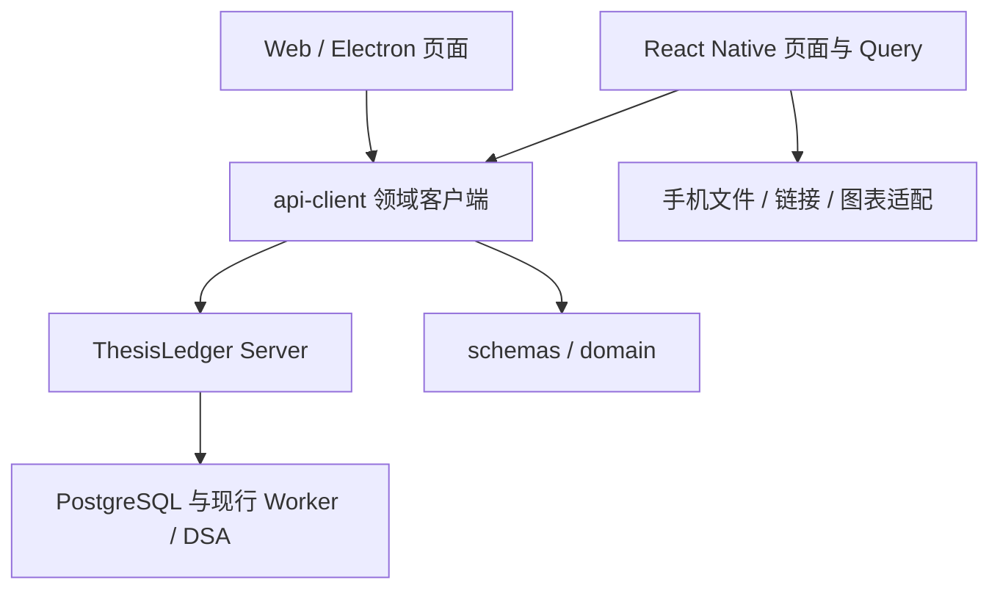

# Web 功能完整迁移至 Android / iOS

> 状态：2026-10-22 用户已授权实施第 0、1 批，保留现有未提交修改。Android/iOS 编译与运行验收分别记录，未通过不标记完成。
> 本规格描述完整迁移目标；当前手机端边界及源码事实见[差异盘点](../reviews/2026-10-22-web-mobile-feature-parity-inventory.md)，当前计划与验收状态见[实施任务](../tasks/2026-10-22-web-mobile-feature-parity.md)。第 2～6 批不在当前实施范围。

> 2026-10-23 实施核对：第 0、1 批实现及 G0A/G0I/G1A/G1I 已按独立证据验收通过。3 处 lint、测试适配、Hermes 跨目录严格锁定构建及 CI 打包前置已修复；授权隔离快照 `dd5115b8` 的完整 CI 六项成功，本机 Android/iOS 分别重编译安装，当前容器自动补验及服务恢复后的账本/Web 对照通过。原工作树保持未提交，历史失败保留；第 2～6 批、真机与签名分发仍按 Task 原边界维护。写入后等待账本、账户与草稿等业务刷新，估值独立呈现陈旧/失败；明确带时区的账本时间转换为同一 UTC 时刻并保留来源时区及精度。

## 背景与目标

原生构建输入需要跨 checkout 目录复现。iOS 保留 `pod install --deployment` 锁定安装；第三方 podspec 的编译器路径使用可解析的相对构建变量，不将机器绝对路径写入依赖校验和。原生补丁通过现有 pnpm 补丁与锁文件维护，并分别验证对应平台原生编译和 CI。

共享 client 迁移后，既有 Web/桌面 CI 必须在独立干净 job 内先按工作区依赖关系构建所需包，不能依赖其他 job 的未上传构建目录。仅修复构建前置顺序，保留安装包生成与校验门禁。

本地原生安装包、截图、日志及验收工具保存在已忽略的手机 release 目录；该目录同时排除出 Server Docker 构建上下文，避免把可重建产物带入服务镜像。

目标 API 因 Docker Desktop 引擎失败不可用时，运行门禁保持未通过。跨整台引擎的恢复需单独确认执行范围，使用 infra 维护的受测入口，先检查正磁盘余量和活动更新，最多重启一次；不删除卷或修改业务配置。应用仍不可用时遵循原有正式更新入口和默认保留数据模式，不通过临时容器命令恢复。

迁移前的 Web 已形成组合、账户数据、收益、风险、复盘、研究、策略、市场数据、数据与自动化等业务界面；当时手机端仅覆盖组合、风险事件和账户的部分能力。用户希望在 Android / iOS 上完成与 Web 相同的业务操作。

目标是业务能力完整对齐：相同输入、账户范围、权限、版本与来源条件下，两端得到相同服务端事实，能够完成相同的读取、编辑、确认、取消、重试、审计与导出流程。手机按触控、小屏、返回和系统文件交互重新组织页面，沿用现有 React Native 工程。

完整性以盘点中每个业务动作及其异常恢复路径为单位；9 个模块都有入口只是导航完成条件。源功能未配置、未准入或因外部条件不可用时，手机必须展示同等原因和操作边界；这不等于该业务已完成实源验收。

## 范围与约束

- 覆盖差异盘点 B01～D07 的现行 Web 可达能力，包括账户和 Ledger 写操作、资金计划、收益目标、策略/回测、研究与管理配置。
- 保留 `apps/mobile/android`、`apps/mobile/ios`，不另建手机项目；Web 的既有 DOM 组件留在 Web。
- Ledger、Portfolio、Risk、Performance、任务生命周期与 Provider 策略继续由 Server 和其现行依赖拥有，手机只访问 ThesisLedger API。
- 各领域现行 Spec 定义金额、身份、时间、修订、幂等、冻结、准入及 AI 权限；迁移不更改这些规则。
- 不新增自动交易、多租户、手机后台计算/调度或离线写账本；网络不可用时保留可识别的旧数据和当前输入，禁止自动排队提交有副作用的命令。
- 迁移不自动启用 Provider、权限、外发渠道、实验或受控研究写入。已有外部门禁继续保留；本方案不以界面迁移解除它们。
- 不需要数据库结构变更。若盘点发现服务端缺口，先形成独立契约任务，再实施；不能在手机任务中顺带改 Schema、Worker 或选路规则。

## 信息架构

采用底部 5 个入口和各模块的原生导航栈：

| 底部入口 | 一级内容及二级功能                                         |
| -------- | ---------------------------------------------------------- |
| 组合     | 组合概览、持仓/交易明细、收益分析、风险中心                |
| 账户     | 账户管理、持仓/草稿、成交、现金、定期入账与定投            |
| 市场     | 标的搜索、行情详情、指标、静态信息、新闻与公告             |
| 研究     | 研究助手、投资复盘、策略库、回测任务与 AI 实验             |
| 更多     | 数据与自动化、行情来源/路由/目录、诊断、服务连接与外观设置 |

默认入口为组合。模块在手机上可以合并导航分组，但所有动作必须在应用内可达。持仓→行情、交易→复盘、研究→引用、策略→回测/风险应用等跳转携带稳定对象 ID、账户与范围；首次只呈现已有数据，跳转本身不触发业务写入。

实际/模拟为全局状态；账户筛选只影响允许该筛选的页面。切换服务、范围或账户前处理未保存输入，取消切换保留原上下文；确认切换后取消旧请求、清理不适用选择，旧响应不得覆盖新上下文。长表转成可筛选分页列表和详情页，复杂编辑采用全屏表单/步骤页，主要动作不依赖悬浮和右键。中文选项与当前回显复用同一标签映射；金额、币种与时间按领域合同显示，不沿用当前手机卡片将所有金额固定显示为 CNY 的局限。

## 技术方案

### 领域合同与依赖方向

- 复用 `packages/domain`、`packages/schemas`、`packages/api-client`。共享运行时校验、领域值和平台无关请求合同；React 组件、DOM、原生模块及页面编排由各端拥有。
- 按功能迁移 Web 本地 API 包装；先补共享领域 client，再让 Web 薄包装与手机共同消费。已经共享的方法仅补必要兼容性证明，不重复实现。
- 新 client 使用领域命名文件，不继续扩大 `api-client/src/index.ts` 的职责；纯展示逻辑只有确实跨端稳定复用时才提升到已有领域所属包，不建立无归属 `shared/utils`。
- 同步维护 `scripts/check-boundaries.mjs`：禁止手机依赖 Desktop、共享包依赖 UI 应用、平台模块进入共享合同。扩充门禁时覆盖合法与非法依赖场景。
- 保留 `/api/v1` 与 `/api/market-data` 等现行路径和错误合同；不能简单拼接同一前缀造成行情请求走错地址。通过已有 client 的绝对/相对路径处理消费。

### 手机基础设施

| 决策       | 默认方案与要求                                                                                                                                                          |
| ---------- | ----------------------------------------------------------------------------------------------------------------------------------------------------------------------- |
| 导航       | 在现有 RN 工程引入 React Navigation 的底部导航和原生栈，保留 `thesis-ledger` scheme；业务参数有类型，覆盖 Android 返回键及未保存输入保护                                |
| 查询与写入 | TanStack Query 管理全部新查询/命令，并逐步替换旧 `MobileReadOnlyStore`；接入原生前后台和网络状态，避免旧 store 与 Query 各自请求同一事实                                |
| 查询键     | 含服务实例、实际/模拟、账户和全部影响结果的参数；翻页、任务 ID、价格口径、周期、指标与窗口不能省略                                                                      |
| 连接       | 提供服务地址编辑、校验、连通性反馈与持久化；保留开发环境默认值。真机不使用 `127.0.0.1` 或 Android 模拟器专用地址，生产连接沿用目标部署的 HTTPS 与访问策略               |
| 本地保存   | 保存非敏感连接与外观偏好；Provider 凭证仅作为本次提交输入，提交后清空，不进入日志、URL、AsyncStorage 或图表消息                                                         |
| 任务进度   | 默认用前台条件轮询读取现行任务 API：有活跃任务时最多每 3 秒一轮、同一查询去重；遵守 `Retry-After`，终态/离页/后台停止，恢复立即重读。不要求手机依赖浏览器 `EventSource` |
| 展示       | 扩展现有原生主题和样式组合，复用可访问命名、状态反馈、确认及数值/时间展示规则；主题、涨跌色偏好持久化                                                                   |

新增原生依赖使用项目 pnpm 和目标 Expo SDK 57 的兼容安装入口，更新锁文件及 Pod/Gradle 输入，并验证原生编译。不要为迁移顺带升级 Expo/RN 大版本。

### 图表、文件与外部链接

行情图表优先采用应用打包的本地 WebView 图表，复用现有 `lightweight-charts` 数据和指标语义；手机其余页面、表单和 API 请求保持原生。先用单标的完成 Android/iOS 的触控、缩放、分页、指标、主题、旋转和资源释放验证，再扩展至收益与回测曲线。

图表桥只接受版本化的展示数据和窗口事件，包含当前对象/请求标识并丢弃过时消息；不向桥传递凭证，不允许任意页面脚本或导航请求 Server。原生层拥有查询、来源校验和窗口预算。候选方案若在设备验证中无法满足交互或性能要求，停止依赖该适配的叶任务，先更新本规格中的渲染决策，不能用静态截图替代图表。

文件能力分为图片/文档选择与文件输出两个边界：使用系统选择器，将 URI、名称和 MIME 交给原生上传适配；保留取消、权限拒绝、内容无效、上传失败和重试行为。共享 API 不要求调用方提供 DOM `File`，multipart 由平台适配产生。回测权益 CSV 在手机保存或分享，内容和编码按现行 Web 生成合同核对。

Provider OAuth 使用系统浏览器打开服务端返回并通过既有白名单校验的授权 URL，沿用现有会话查询/取消机制；返回应用后重查会话。原文链接也使用系统链接能力。既有服务端回调负责接收 OAuth 结果，迁移默认不新建另一套手机回调协议。

### 写入和恢复不变量

1. 账本命令的幂等 ID 在同一次重试期间稳定；遵守现行 `expectedRevision`、`expectedVersion` 等合同。409 必须显示原因并重读/由用户确认，不能偷偷换版本重试。
2. 草稿编辑、保存、选行和最终提交分开；完整快照造成的遗漏归零、删除/清空、计划状态变更等保持 Web 同等确认语义。确定性录入/对账不依赖模型。
3. 服务端已成功写入但后续刷新失败时，显示“操作成功、数据尚未刷新”并提供重读，不能提示写入失败并诱导重复命令。
4. 后台或网络变化不自动重发修改、扫描、研究、回测、Provider 测试或自动化执行；恢复只重读事实。需要副作用的动作只能由用户显式提交。
5. 来源不可用、部分失败、陈旧、未配置、未准入和真正空数据区分展示；不补零、不伪造完成、不把缓存成功当成最新可写依据。
6. 研究/复盘保留引用和不可变报告历史；AI 不直接写 Ledger、Position 或 Order，客户端不伪造 Provider、模型、Prompt 等服务端审计事实。

## 分批交付与顺序

| 批次 | 可独立使用的交付                               | 退出条件                                                                        |
| ---- | ---------------------------------------------- | ------------------------------------------------------------------------------- |
| 0    | 导航、连接、Query、文件/图表适配与早期双端构建 | 两个平台能安装启动，连接正确 API，已有功能回归；图表与文件适配先证明可行        |
| 1    | 账户、人工录入/草稿、成交与组合/交易           | 用受控模拟账户完成“新建→录入→查看组合→记成交→跨端重读”，包含冲突及失败恢复      |
| 2    | 现金/定期计划、收益、风险、市场详情与资讯      | 相同输入的 Web/手机对照；规则、目标及资金写入分别验收，图表/信息保留来源        |
| 3    | 投资复盘和研究助手                             | 阅读、编辑/提交、引用追踪、历史及失败恢复完成；原研究外部条件按原 Task 保留     |
| 4    | 策略库、回测、净值回测、实验与风险应用         | 手机可完成创建到终态、取消/重试、重启恢复、结果查看及 CSV 输出                  |
| 5    | AI/行情来源、路由目录、自动化与诊断            | 配置可在手机完成；Desired/Effective、探针、任务历史与错误原因可观察             |
| 6    | 全功能差集核销与发布候选验收                   | 每个业务动作有 Android/iOS 证据；真实 API、目标设备、Web 回归及文档一致性均满足 |

这是完整目标的分批交付，不把后续批次移入 TODO。与正在实施的主线共存，默认不改原 P0/P1 排序。先完成第 0、1 批并据真实迁移吞吐、原生依赖和设备耗时校准余下排期；源码盘点不足以给出可靠的固定完成日期。

## 验收标准

- AC01：基线中的全部业务动作都有手机实现责任与 Android/iOS 验证责任；新增 Web 差集能被发现并纳入，不能用入口数量替代覆盖率。
- AC02：导航、对象跳转、实际/模拟与账户上下文、连接设置、主题/涨跌色及未保存输入保护在两平台成立；前后台和断网恢复不串数据。
- AC03：两端共享平台无关领域合同，手机只访问 Server；运行时校验、URL 解析、错误及依赖门禁成立，Web 原功能通过对应回归。
- AC04：账户管理、手工基线、草稿修订/选行、截图、成交更正/作废/恢复、确定性对账及审计在手机可完成，并保留修订/幂等/确认约束。
- AC05：现金观察/入账/转账及其更正、定期入账、基金定投的手机行为与现行 Server 合同一致，调度与终态不转移至手机。
- AC06：组合/交易及收益读写完整；相同范围、时间和 FX 输入得到相同服务端结果，保存与刷新失败的反馈分开。
- AC07：行情窗口、周期、复权、指标、净值、静态资料、新闻/公告及来源可在手机消费；图表手势、分页和资源生命周期通过设备验证。
- AC08：规则管理、试算/扫描、事件、通知/路由状态、审计及策略风险应用在手机可用，不掩盖部分失败或版本冲突。
- AC09：单笔/行为/区间复盘、草稿、快照/历史、AI 解释与引用均有手机流程，确定性事实与 AI 解释保持边界。
- AC10：研究列表/报告/引用/工具审计、新研究/重试、比较/复核按现行可用性在手机可达，受控能力不因迁移自动激活。
- AC11：策略定义/版本/辅助编写、普通与净值回测、实验/比较/采用/结束可在手机完成；任务恢复、取消/重试及导出不依赖页面持续存活。
- AC12：AI Provider/模型/用途配置、行情 Provider/账号/OAuth、路由/目录、自动化和诊断有完整手机操作及反馈，凭证不落入本地持久化和日志。
- AC13：图片/文档选择、上传、CSV 输出/分享和系统浏览器返回均通过 Android/iOS 原生验证；取消、权限拒绝和失败可恢复。
- AC14：完成定向→包级→仓库门禁→原生编译→目标 API 与设备分层验证；历史、fixture、Expo Web 或 `tsc` 证据不能替代新目标设备验收，必要外部条件缺失时相关验收保持未完成。
- AC15：业务与手机文档、现行 Spec/Task 及来源矩阵一致；旧 store 仅在其消费者已迁移并回归后移除；保留既有数据和无关 WIP。

## 验证策略与停止条件

本地使用定向合同与业务测试验证数值、状态、冲突、幂等、失败保稿及读取失败保护；共享 client 同时验证 Web 与 RN 传输。包级检查使用现有 `typecheck`、`test`，原生变更执行实际 Gradle/Xcode 编译，iOS 增加与 Android 对应的 CI 门禁。

每批分别登记 Android、iOS 的验收叶，记录源码/锁文件、API 版本、数据库 head、设备、输入、操作及结果。目标 API/部署输入保持一致；只有相应输入变化才重跑已过高成本检查。需要更新目标 Docker 时按相邻 infra 的正式入口选择最小目标，遵守保留数据边界。

最早的真实语义闭环为第 1 批的受控模拟账户，不能等全部界面完成才验证 HTTP/设备交互。后续每批执行其独立运行门禁；最终门禁只汇总遗漏、跨模块联动与发布候选风险，不替代各批验收。

当前实施范围在第 0、1 批验收完成后停止；单平台或单叶阻塞时继续其他独立且已授权事项。环境地址、可用设备、签名/分发、真实 Provider/模型与外发授权缺失只阻塞对应运行叶，不能作为降低验收标准的理由。

## 风险、默认值与待准备资源

| 项目                  | 处置与影响范围                                                                                     |
| --------------------- | -------------------------------------------------------------------------------------------------- |
| Web 正在持续变化      | 实施前冻结一份动作清单和源码指纹，每批开始核对差集；不得将旧盘点当作永久事实                       |
| 图表和导入原生兼容    | 第 0 批先做适配验证；失败先重定渲染/文件契约，再启动依赖界面                                       |
| 部分类型只在 Web 定义 | 按领域提升稳定 wire schema，先契约后消费；不把页面状态和 DOM 类型一起迁移                          |
| 单批过大              | Task 的独立叶各自完成；若一个叶需要同时修改 Server/Worker 或新增状态机，应停止并拆分               |
| 真机网络与访问策略    | 默认复用用户现有可信部署；目标地址与访问条件在运行门禁前核对。本方案不自动开放公网或改服务器认证   |
| 实源/模型/通知        | 复用未变化且有效的已有证据，缺少的沿用原任务阻塞。应用内有按钮不能代表这部分业务已验收             |
| 发布资源              | Android/iOS 签名、设备和分发渠道在候选发布前落实；本地 debug 或 Simulator 构建不能代表正式分发完成 |

当前没有必须重新询问才能形成方案的产品分歧；上述导航、轮询、图表和连接策略是本方案的明确默认值。若用户调整某项，先更新受影响合同和任务依赖。

## 第 0、1 批运行中发现的导入响应修复

原生上传必须使用当前 Expo fetch 支持的文件二进制接口，并保留选择器给出的名称与 MIME。设备验收发现服务端直接返回 Prisma Decimal，以及缺少来源时间的草稿修订返回空时间精度，均违反现有 wire Schema。按独立任务 C02a 修复导入模块的响应映射：置信度返回有限的 0～1 数字，缺失的时间精度明确返回 `UNKNOWN`；不得为通过校验推测观察时间、修改既有持仓或放宽 Schema。先验证映射与空草稿读取，再通过正式部署入口更新目标运行态，最后分别复验双端上传、审核列表及账本版本未变化。

## 官方技术依据

- [React Navigation 安装与 Expo 兼容依赖](https://reactnavigation.org/docs/getting-started/)：支持现有 RN 项目接入，原生导航依赖按目标 Expo SDK 安装。
- [TanStack Query 的 React Native 接入](https://tanstack.com/query/latest/docs/framework/react/react-native)：网络与前后台状态需要原生生命周期接入。
- [Expo SDK 57 DocumentPicker](https://docs.expo.dev/versions/v57.0.0/sdk/document-picker/) 与 [ImagePicker](https://docs.expo.dev/versions/v57.0.0/sdk/imagepicker/)：系统文件/图片选择入口。
- [Expo SDK 57 的 react-native-webview](https://docs.expo.dev/versions/v57.0.0/sdk/webview/)：本地图表适配的候选原生容器。采用它能否满足本项目图表交互仍由第 0 批设备验证决定。
