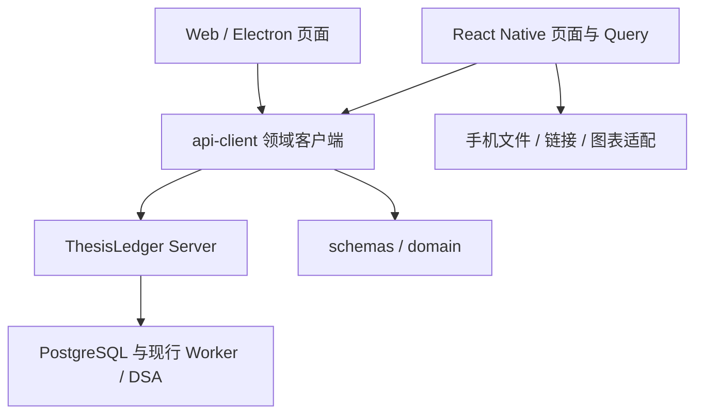

# Web 功能完整迁移至 Android / iOS

> 验收范围调整（2026-10-25）：按用户要求，运行验收使用 Android Emulator 与 iOS Simulator；真机、正式签名（含 signed archive/IPA 正式导出）及选定渠道结果已移出迁移验收范围。当前必需层级为原生编译、当前源码 CI、目标 API、双端模拟器及原业务实源；见[范围调整记录](../tasks/evidence/web-mobile-parity/2026-10-25-acceptance-scope.md)。

> 已有工具交付：2026-10-25 无凭据构建与校验准备的本机范围已通过。模板、校验/接续脚本及无上传工作流齐备，Android Release 缺材料不再回退 debug key；Android Debug/未签名 Release、iOS Simulator Debug/iPhoneOS 未签名 archive 分别通过，见[当次记录](../tasks/evidence/web-mobile-parity/2026-10-25-release-preparation.md)。当时尚未推送；2026-10-26 接续提交 `feea66c1` 的 quality、contracts、Android/iOS Native 四项主 CI 及默认工具检查均成功，桌面打包跳过、无 artifact。真实手动历史双端消费、G6 独立资源差集及当前动作输入核对已通过，见[接续记录](../tasks/evidence/web-mobile-parity/2026-10-26-continuation.md)。下文 `e8a258d6` 与 64 输入复用描述均属于工具增量之前的验收基线，当前迁移状态以 Task 为准。

> 2026-10-24 接续：第 2 批的研究模型绑定合同由[研究规格的模型绑定补验](2026-10-18-research-evidence-evolution.md#研究报告实际模型绑定补验2026-10-24)负责；市场回归路径修正已一并进入隔离快照并通过实际 CI。手动 CI 增加保留原默认值的桌面打包开关，本批关闭打包以遵守安装包不上传的范围，quality、contracts 及两端 Native job 完整执行。

> 状态：2026-10-26；第 0～4 批实现与分平台运行通过，第 5 批受控交互和通用 OAuth 状态补验通过，G5SA/G5SI 已完成真实单次 Scheduler 及 Android/iPhone Air 消费。第 6 批独立差集、原生编译与已验快照 `feea66c1` 的四项主 CI 按匹配输入复用。当前剩余为 G5A/G5I 的模型/来源、路由/目录写入、通知，以及完整 G6A/G6I、G7；已确认后续范围按下方 TODO 引用执行。原树未暂存、未提交；并发差异与历史失败如实留证。
> 本规格描述完整迁移目标；迁移起点与当前源码增量见[差异盘点](../reviews/2026-10-22-web-mobile-feature-parity-inventory.md)，当前计划、运行缺口及证据以[实施任务](../tasks/2026-10-22-web-mobile-feature-parity.md)为准。第 6 批模拟器预检按实际覆盖复用；本轮已通过的当前源码 CI、独立模拟器差集与仍未完成的业务实源分别记录，不据此关闭完整 G5/G6/G7。

> 工具准备之前的剩余条件核对（2026-10-25）：当时 189 个手机生产文件、64 个原生/打包输入及已验本机测试输入未变。随后工具准备修改 Android Gradle 与两份 iOS 原生配置，已独立原生编译验证；手机业务源码未变。[剩余门禁记录](../tasks/evidence/web-mobile-parity/2026-10-25-remaining-gates.md)保留调整前的历史核对，当前完成条件由本规格和 Task 维护。

第 3 批沿用复盘与研究的现行服务端合同：确定性事实、草稿、AI 解释及不可变快照分别保存；事实指纹、算法或草稿改变后必须重新分析才能保存。区间按显式时区转换，采用左闭右开窗口。研究读取按当前模式与可信范围隔离，旧报告使用明确的历史兼容入口；请求失败保留已读正文。新建使用服务端能力与模型设置预检，提交标识和原始输入先持久化，再调用提交/找回/取消接口；审计、用量、实际模型及材料来源只读。比较和复核沿用服务端可用状态，不启用受控写入，也不因迁移扩大原研究任务的模型调用、启停及预算边界。正向自动验收使用隔离数据库及受控响应，不能据此勾选实源验收。

> 第 0、1 批历史核对（2026-10-23）：G0A/G0I/G1A/G1I 已按独立证据验收通过。3 处 lint、测试适配、Hermes 跨目录严格锁定构建及 CI 打包前置已修复；授权隔离快照 `dd5115b8` 的完整 CI 六项成功，本机 Android/iOS 分别重编译安装，对应容器自动补验及服务恢复后的账本/Web 对照通过。该段只属于历史输入；第 2 批现行结果见 Task。写入后等待账本、账户与草稿等业务刷新，估值独立呈现陈旧/失败；明确带时区的账本时间转换为同一 UTC 时刻并保留来源时区及精度。

## 背景与目标

原生构建输入需要跨 checkout 目录复现。iOS 保留 `pod install --deployment` 锁定安装；第三方 podspec 的编译器路径使用可解析的相对构建变量，不将机器绝对路径写入依赖校验和。原生补丁通过现有 pnpm 补丁与锁文件维护，并分别验证对应平台原生编译和 CI。

共享 client 迁移后，既有 Web/桌面 CI 必须在独立干净 job 内先按工作区依赖关系构建所需包，不能依赖其他 job 的未上传构建目录。仅修复构建前置顺序，保留安装包生成与校验门禁。

本地原生安装包、截图、日志及验收工具保存在已忽略的手机 release 目录；该目录同时排除出 Server Docker 构建上下文，避免把可重建产物带入服务镜像。

目标 API 因 Docker Desktop 引擎失败不可用时，运行门禁保持未通过。跨整台引擎的恢复需单独确认执行范围，使用 infra 维护的受测入口，先检查正磁盘余量和活动更新，最多重启一次；不删除卷或修改业务配置。应用仍不可用时遵循原有正式更新入口和默认保留数据模式，不通过临时容器命令恢复。

迁移前的 Web 已形成组合、账户数据、收益、风险、复盘、研究、策略、市场数据、数据与自动化等业务界面；当时手机端仅覆盖组合、风险事件和账户的部分能力。用户希望在 Android / iOS 上完成与 Web 相同的业务操作。

目标是业务能力完整对齐：相同输入、账户范围、权限、版本与来源条件下，两端得到相同服务端事实，能够完成相同的读取、编辑、确认、取消、重试、审计与导出流程。手机按触控、小屏、返回和系统文件交互重新组织页面，沿用现有 React Native 工程。

完整性以盘点中每个业务动作及其异常恢复路径为单位；9 个模块都有入口只是导航完成条件。源功能未配置、未准入或因外部条件不可用时，手机必须展示同等原因和操作边界；这不等于该业务已完成实源验收。

## 范围与约束

- 覆盖差异盘点 B01～D07 的现行 Web 可达能力，包括账户和 Ledger 写操作、资金计划、收益目标、策略/回测、研究与管理配置。
- 保留 `apps/mobile/android`、`apps/mobile/ios`，不另建手机项目；Web 的既有 DOM 组件留在 Web。
- Ledger、Portfolio、Risk、Performance、任务生命周期与 Provider 策略继续由 Server 和其现行依赖拥有，手机只访问 ThesisLedger API。
- 各领域现行 Spec 定义金额、身份、时间、修订、幂等、冻结、准入及 AI 权限；迁移不更改这些规则。
- 不新增自动交易、多租户、手机后台计算/调度或离线写账本；网络不可用时保留可识别的旧数据和当前输入，禁止自动排队提交有副作用的命令。
- 迁移不自动启用 Provider、权限、外发渠道、实验或受控研究写入。已有外部门禁继续保留；本方案不以界面迁移解除它们。
- 不需要数据库结构变更。若盘点发现服务端缺口，先形成独立契约任务，再实施；不能在手机任务中顺带改 Schema、Worker 或选路规则。
- Android 与 iOS 的运行验收分别在 Emulator、Simulator 执行，覆盖交互、可访问命名与读屏树、系统文件、权限、前后台及资源生命周期；分别记录原生编译和当前源码 CI。

2026-10-26 范围确认：用户明确将 Longbridge 真实账号授权、回调成功及后续行情/令牌刷新验收延期至 [TODO](../TODO.md#longbridge-oauth-live-acceptance)。M29b 的该实源缺口不属于当前迁移完成条件，不列入当前剩余任务，也不阻塞 G5A/G5I、完整 G6A/G6I 或 G7。已交付的通用 OAuth 合同、系统浏览器、取消/过期与受控终态行为继续保留；延期事项没有验收通过结论。

### 正式签名与发布准备

G6RA/G6RI/G6RC 已交付无凭据模板、构建/校验与接续脚本。本节保留已实现工具的使用约束，仅在显式选择相应操作时适用；可选签名/导出流程见[工具说明](../guides/2026-10-25-mobile-release-preparation.md)。当前迁移门禁按 AC14 执行，不要求提供这些可选操作的材料或执行结果。

- 正式 Android Release 缺少完整签名输入时必须拒绝，不得回退 debug key；仅显式未签名准备模式可产生编译候选，Debug 保持可用。未签名产物单独命名、不能当作正式包。
- 配置模板只承载包标识、版本、目标 API、公开证书指纹、Team/profile 及渠道方式；密码与私钥通过既有安全环境提供，不进入模板、命令参数、回执或日志。
- Android 校验必须验证密码学签名、证书 SHA-256 固定值、包名/版本和非 debuggable；APK 与 AAB 使用各自原生验证工具，不凭扩展名或 Release 文件名通过。
- iOS 校验须验证 iPhoneOS 平台、包标识/版本、签名证书固定值与 Team、描述文件有效期/用途/证书绑定、entitlements 及禁用调试资格；Simulator、无 profile 或过期/错 Team 的包不得通过正式校验。
- iOS 版本和手动签名参数只绑定 App target，不改写 Pods 的版本或签名设置；默认实际包版本保持 `0.1.0/1`，构建参数与产物版本必须一致。材料相对路径在进入原生工具前固定，不能因工作目录变化读错文件。
- 接续分为计划、显式未签名编译、具备材料后的本机签名/导出、产物校验；每阶段保存输入和产物哈希，失败不推进。iOS 导出强制 `destination=export`，脚本与新流水线均不包含上传、发布、自动登记或获取签名材料的动作。
- 新流水线默认执行配置/反例检查，手动选择时才进行无凭据原生候选编译；不上传 artifact。当前源码远端 CI 未运行时保持未通过，可选工具回执只记录实际执行结果。

## 信息架构

采用底部 5 个入口和各模块的原生导航栈：

| 底部入口 | 一级内容及二级功能                                         |
| -------- | ---------------------------------------------------------- |
| 组合     | 组合概览、持仓/交易明细、收益分析、风险中心                |
| 账户     | 账户管理、持仓/草稿、成交、现金、定期入账与定投            |
| 市场     | 标的搜索、行情详情、指标、静态信息、新闻与公告             |
| 研究     | 研究助手、投资复盘、策略库、回测任务与 AI 实验             |
| 更多     | 数据与自动化、行情来源/路由/目录、诊断、服务连接与外观设置 |

默认入口为组合。模块在手机上可以合并导航分组，但所有动作必须在应用内可达。持仓→行情、交易→复盘、研究→引用、策略→回测/风险应用等跳转携带稳定对象 ID、账户与范围；首次只呈现已有数据，跳转本身不触发业务写入。

实际/模拟为全局状态；账户筛选只影响允许该筛选的页面。切换服务、范围或账户前处理未保存输入，取消切换保留原上下文；确认切换后取消旧请求、清理不适用选择，旧响应不得覆盖新上下文。长表转成可筛选分页列表和详情页，复杂编辑采用全屏表单/步骤页，主要动作不依赖悬浮和右键。中文选项与当前回显复用同一标签映射；金额、币种与时间按领域合同显示，不沿用当前手机卡片将所有金额固定显示为 CNY 的局限。

## 技术方案

### 领域合同与依赖方向

- 复用 `packages/domain`、`packages/schemas`、`packages/api-client`。共享运行时校验、领域值和平台无关请求合同；React 组件、DOM、原生模块及页面编排由各端拥有。
- 按功能迁移 Web 本地 API 包装；先补共享领域 client，再让 Web 薄包装与手机共同消费。已经共享的方法仅补必要兼容性证明，不重复实现。
- 新 client 使用领域命名文件，不继续扩大 `api-client/src/index.ts` 的职责；纯展示逻辑只有确实跨端稳定复用时才提升到已有领域所属包，不建立无归属 `shared/utils`。
- 同步维护 `scripts/check-boundaries.mjs`：禁止手机依赖 Desktop、共享包依赖 UI 应用、平台模块进入共享合同。扩充门禁时覆盖合法与非法依赖场景。
- 保留 `/api/v1` 与 `/api/market-data` 等现行路径和错误合同；不能简单拼接同一前缀造成行情请求走错地址。通过已有 client 的绝对/相对路径处理消费。

### 研究报告工具审计的范围边界

手机报告的工具历史通过 `GET /research/reports/:id/tool-calls` 读取，携带与正文相同的 locator，并在同一 RepeatableRead 事务内按当前身份、保存的模式/对象范围和当前访问权限授权。旧 `/ai/runs/:id/tool-calls` 继续只服务旧记录，不放宽到有 owner 的 V2。新接口仅返回该 run 的持久化审计摘要（含失败/拒绝），以创建时间及 ID 稳定分页；游标绑定 owner、run 和 locator，拒绝跨范围、跨报告或畸形游标。读取无模型、来源探测、补投或业务写入副作用。手机沿用 TanStack Query 的取消、错误保持和模式键隔离；全部冻结材料按 evidenceBindings 提供入口，覆盖只在数值或其他结构化段落被引用的材料。

### 手机基础设施

| 决策       | 默认方案与要求                                                                                                                                                          |
| ---------- | ----------------------------------------------------------------------------------------------------------------------------------------------------------------------- |
| 导航       | 在现有 RN 工程引入 React Navigation 的底部导航和原生栈，保留 `thesis-ledger` scheme；业务参数有类型，覆盖 Android 返回键及未保存输入保护                                |
| 查询与写入 | TanStack Query 管理手机运行路径的查询/命令；退休无运行消费者的旧 bootstrap/store 及重复账户查询入口，保留仍使用的展示类型。接入原生前后台和网络状态，避免两个执行路径重复读取同一事实 |
| 查询键     | 含服务实例、实际/模拟、账户和全部影响结果的参数；翻页、任务 ID、价格口径、周期、指标与窗口不能省略                                                                      |
| 连接       | 提供服务地址编辑、校验、连通性反馈与持久化；保留开发环境默认值。模拟器回环地址仅用于本机开发，生产连接沿用目标部署的 HTTPS 与访问策略                                    |
| 本地保存   | 保存非敏感连接与外观偏好；Provider 凭证仅作为本次提交输入，提交后清空，不进入日志、URL、AsyncStorage 或图表消息                                                         |
| 任务进度   | 默认用前台条件轮询读取现行任务 API：有活跃任务时最多每 3 秒一轮、同一查询去重；遵守 `Retry-After`，终态/离页/后台停止，恢复立即重读。不要求手机依赖浏览器 `EventSource` |
| 展示       | 扩展现有原生主题和样式组合，复用可访问命名、状态反馈、确认及数值/时间展示规则；主题、涨跌色偏好持久化                                                                   |

新增原生依赖使用项目 pnpm 和目标 Expo SDK 57 的兼容安装入口，更新锁文件及 Pod/Gradle 输入，并验证原生编译。不要为迁移顺带升级 Expo/RN 大版本。

### 图表、文件与外部链接

行情图表优先采用应用打包的本地 WebView 图表，复用现有 `lightweight-charts` 数据和指标语义；手机其余页面、表单和 API 请求保持原生。先用单标的完成 Android/iOS 的触控、缩放、分页、指标、主题、旋转和资源释放验证，再扩展至收益与回测曲线。

图表桥只接受版本化的展示数据和窗口事件，包含当前对象/请求标识并丢弃过时消息；不向桥传递凭证，不允许任意页面脚本或导航请求 Server。原生层拥有查询、来源校验和窗口预算。候选方案若在双端模拟器验证中无法满足交互或性能要求，停止依赖该适配的叶任务，先更新本规格中的渲染决策，不能用静态截图替代图表。

首次拟合视口必须等待本地 WebView 获得有效宽高，并在布局帧中执行；就绪消息继续等待拟合绘制完成，避免原生首次回传覆盖尚未生效的拟合。零尺寸期间收到的数据只更新展示输入。后续尺寸变化保留用户的窗口与缩放，离页释放尺寸观察和待执行帧。该约束同时覆盖 K 线与收益折线，不能仅以 WebView 存在或接口返回点数判定渲染通过。

CI 的市场回归命令须逐一确认所列测试文件存在，再执行当前维护的读取器、图表及指标窗口测试；不能把匹配不到的路径视为已通过。已有无关步骤失败时，本批可通过既有隔离入口补验独立领域，但本机补验不改写远端 CI 的失败或未执行状态。

文件能力分为图片/文档选择与文件输出两个边界：使用系统选择器，将 URI、名称和 MIME 交给原生上传适配；保留取消、权限拒绝、内容无效、上传失败和重试行为。共享 API 不要求调用方提供 DOM `File`，multipart 由平台适配产生。回测权益 CSV 在手机保存或分享，内容和编码按现行 Web 生成合同核对。

Provider OAuth 使用系统浏览器打开服务端返回并通过既有白名单校验的授权 URL，沿用现有会话查询/取消机制；返回应用后重查会话。原文链接也使用系统链接能力。既有服务端回调负责接收 OAuth 结果，迁移默认不新建另一套手机回调协议。

### 写入和恢复不变量

1. 账本命令的幂等 ID 在同一次重试期间稳定；遵守现行 `expectedRevision`、`expectedVersion` 等合同。409 必须显示原因并重读/由用户确认，不能偷偷换版本重试。
2. 草稿编辑、保存、选行和最终提交分开；完整快照造成的遗漏归零、删除/清空、计划状态变更等保持 Web 同等确认语义。确定性录入/对账不依赖模型。
3. 服务端已成功写入但后续刷新失败时，显示“操作成功、数据尚未刷新”并提供重读，不能提示写入失败并诱导重复命令。
4. 后台或网络变化不自动重发修改、扫描、研究、回测、Provider 测试或自动化执行；恢复只重读事实。需要副作用的动作只能由用户显式提交。
5. 来源不可用、部分失败、陈旧、未配置、未准入和真正空数据区分展示；不补零、不伪造完成、不把缓存成功当成最新可写依据。
6. 研究/复盘保留引用和不可变报告历史；AI 不直接写 Ledger、Position 或 Order，客户端不伪造 Provider、模型、Prompt 等服务端审计事实。

## 分批交付与顺序

| 批次 | 可独立使用的交付                               | 退出条件                                                                        |
| ---- | ---------------------------------------------- | ------------------------------------------------------------------------------- |
| 0    | 导航、连接、Query、文件/图表适配与早期双端构建 | 两平台模拟器能安装启动，连接正确 API，已有功能回归；图表与文件适配先证明可行    |
| 1    | 账户、人工录入/草稿、成交与组合/交易           | 用受控模拟账户完成“新建→录入→查看组合→记成交→跨端重读”，包含冲突及失败恢复      |
| 2    | 现金/定期计划、收益、风险、市场详情与资讯      | 相同输入的 Web/手机对照；规则、目标及资金写入分别验收，图表/信息保留来源        |
| 3    | 投资复盘和研究助手                             | 阅读、编辑/提交、引用追踪、历史及失败恢复完成；原研究外部条件按原 Task 保留     |
| 4    | 策略库、回测、净值回测、实验与风险应用         | 手机可完成创建到终态、取消/重试、重启恢复、结果查看及 CSV 输出                  |
| 5    | AI/行情来源、路由目录、自动化与诊断            | 配置可在手机完成；Desired/Effective、探针、任务历史与错误原因可观察             |
| 6    | 全功能差集核销与集成验收                       | 每个业务动作有 Android/iOS 证据；目标 API、双端模拟器、当前源码 CI 及文档断言均满足 |

这是完整目标的分批交付，不把后续批次移入 TODO。与正在实施的主线共存，默认不改原 P0/P1 排序。先完成第 0、1 批并据真实迁移吞吐、原生依赖和模拟器验收耗时校准余下排期；源码盘点不足以给出可靠的固定完成日期。

## 验收标准

- AC01：基线中的全部业务动作都有手机实现责任与 Android/iOS 验证责任；新增 Web 差集能被发现并纳入，不能用入口数量替代覆盖率。
- AC02：导航、对象跳转、实际/模拟与账户上下文、连接设置、主题/涨跌色及未保存输入保护在两平台成立；前后台和断网恢复不串数据。
- AC03：两端共享平台无关领域合同，手机只访问 Server；运行时校验、URL 解析、错误及依赖门禁成立，Web 原功能通过对应回归。
- AC04：账户管理、手工基线、草稿修订/选行、截图、成交更正/作废/恢复、确定性对账及审计在手机可完成，并保留修订/幂等/确认约束。
- AC05：现金观察/入账/转账及其更正、定期入账、基金定投的手机行为与现行 Server 合同一致，调度与终态不转移至手机。
- AC06：组合/交易及收益读写完整；相同范围、时间和 FX 输入得到相同服务端结果，保存与刷新失败的反馈分开。
- AC07：行情窗口、周期、复权、指标、净值、静态资料、新闻/公告及来源可在手机消费；图表手势、分页和资源生命周期通过双端模拟器验证。
- AC08：规则管理、试算/扫描、事件、通知/路由状态、审计及策略风险应用在手机可用，不掩盖部分失败或版本冲突。
- AC09：单笔/行为/区间复盘、草稿、快照/历史、AI 解释与引用均有手机流程，确定性事实与 AI 解释保持边界。
- AC10：研究列表/报告/引用/工具审计、新研究/重试、比较/复核按现行可用性在手机可达，受控能力不因迁移自动激活。
- AC11：策略定义/版本/辅助编写、普通与净值回测、实验/比较/采用/结束可在手机完成；任务恢复、取消/重试及导出不依赖页面持续存活。
- AC12：AI Provider/模型/用途配置、行情 Provider/账号、通用 OAuth 状态交互、路由/目录、自动化和诊断有完整手机操作及反馈，凭证不落入本地持久化和日志；Longbridge 实源后续范围按上述 TODO 边界执行。
- AC13：图片/文档选择、上传、CSV 输出/分享和系统浏览器返回均通过 Android/iOS 原生验证；取消、权限拒绝和失败可恢复。
- AC14：完成定向→包级→仓库门禁→原生编译→目标 API 与 Android Emulator/iOS Simulator 运行的分层验证，分别记录源码/锁文件、未签名或 Debug 构建产物及当前源码 CI。历史、fixture、Expo Web 或 `tsc` 证据不能替代当前输入对应层级的验收，必要业务实源条件缺失时相关验收保持未完成。
- AC15：业务与手机文档、现行 Spec/Task 及来源矩阵一致；旧 store 仅在其消费者已迁移并回归后移除；保留既有数据和无关 WIP。

## 第 4 批执行边界

策略定义、辅助编写、普通与净值 Run、优化实验及风险应用使用现行 Server 合同与共享 Schema/client，不引入另一套执行状态机。策略编辑保留完整定义和版本来源，修改现有定义通过明确的新版本保存；辅助编写将草稿、操作、建议、采用与最终保存分开，修订冲突和失败不得丢弃用户输入或自动采用模型结果。

普通与净值回测都必须先准备和冻结输入；参数变更后原准备结果失效。提交标识在请求前持久化，不确定结果先查询原提交；没有独立找回接口时，仅由用户明确确认后，以同一冻结输入和幂等标识重取收据，不生成新标识。轮询失败不当作任务丢失，也不触发补投。取消、重试和终态均按服务端 Run/attempt 重读，来源、冻结证据及 CSV 保持现行口径。实验的创建/克隆/改名/取消/结束与候选采用分开，采用和风险应用升级必须核对版本、预览指纹及幂等标识，不自动启用模型、来源、通知或预算。

验收先证明共享合同与受控业务闭环，再分别执行 Android/iOS 原生编译及自动运行。正向模型和外部行情样本只在本机明确标记的受控响应或既有隔离测试中执行；真实 API 仅操作本轮自建对象，并保留原账本、Run、Snapshot 与设置。原业务任务的实源、队列、Worker、模型及预算验收不被手机受控通过替代。公开 CI 先制作限定清单，沿用已验冻结基线；超出既有批次公开授权时，在可审查快照准备完成后单独取得授权。

## 验证策略与停止条件

本地使用定向合同与业务测试验证数值、状态、冲突、幂等、失败保稿及读取失败保护；共享 client 同时验证 Web 与 RN 传输。包级检查使用现有 `typecheck`、`test`，原生变更执行实际 Gradle/Xcode 编译，iOS 增加与 Android 对应的 CI 门禁。

每批分别登记 Android、iOS 的验收叶，记录源码/锁文件、API 版本、数据库 head、模拟器及系统版本、输入、操作及结果。目标 API/部署输入保持一致；只有相应输入变化才重跑已过高成本检查。需要更新目标 Docker 时按相邻 infra 的正式入口选择最小目标，遵守保留数据边界。

最早的真实语义闭环为第 1 批的受控模拟账户，不能等全部界面完成才验证 HTTP/模拟器原生交互。后续每批执行其独立运行门禁；最终门禁只汇总遗漏、跨模块联动与集成风险，不替代各批验收。

图表适配的序列容量覆盖 Server 默认完整配置：MA 四条、MACD 三条、RSI 三条，最多十条指标序列；第十一条仍拒绝。每条序列和 K 线各自保留 3000 点上限，并继续验证时间严格有序、数值有效、窗格范围和桥接实例身份。该容量对应第 2 批实际 wire 响应，不能用旧八条限制把完整配置误判为坏数据。

港美证券参考资料保留按代码读取的独立入口，避免当前目录覆盖不足阻断现有能力。代码和资产类型继续按共享 Schema 校验，返回的标的身份必须与请求一致；静态资料和港股每手查询分别显示结果与失败原因。

当前授权实施范围已接续至第 5 批；用户已依据本批清单授权隔离快照及限定必要修复运行公开 CI，原树不暂存、不提交，临时分支不合并。单平台或单叶阻塞时继续其他独立且已授权事项。环境地址、可用模拟器、当前源码 CI、真实 Provider/模型与业务外发授权缺失只阻塞对应运行叶，不能作为降低验收标准的理由。

### 第 5 批执行边界

沿用现行 AI Provider 配置、验证保存、模型/用途路由及生成超时合同；连接验证、用途验证证据、配置保存与启用分别显示。启用配置按服务端预检计划、显式预算授权和验证保存流程执行；未知费用不补零，不以连接成功冒充用途可用。研究默认模型修改及 Provider 停用/删除携带现行修订和默认引用处理条件。

API Key 与行情凭证只驻留当前原生表单内存，使用安全输入；提交、取消和离页后清空，不写 AsyncStorage、查询键、日志或持久化草稿。响应按只读摘要合同校验，不接收秘密字段；写入失败保留非敏感输入，不自动重发可能产生调用、通知或配置副作用的操作。OAuth 只接受现行白名单授权地址，通过系统浏览器和 Server 会话查询恢复，浏览器返回不等同授权成功。

行情账号能力、准入、Desired/Effective 策略和目录任务终态分别消费，保持乐观修订与现行错误语义。自动化由 Server 执行，手机只管理与查询；读取失败不补投、不外发，立即执行有独立明确确认。

第 5 批原生正向写入使用明示本机受控接收端及非秘密哨兵值，真实 API 只读核对配置、策略与账本保护，不更改真实模型、默认值、行情路由、目录、任务启停或通知。当前范围内的真实模型、来源、路由/目录写入和外发条件仍由原任务持有，缺失的必需外部断言逐项保留未完成；Longbridge 后续范围仅由 TODO 索引。Android 与 iOS 各自记录编译、安装、交互及恢复；原工作树不暂存、不提交。

2026-10-26 剩余任务接续增加真实手动执行的独立验证面：仅新建本轮具名、始终停用的 `daily-digest` 测试任务，手动运行一次并读取持久化历史。该处理器只读已有风险事件并生成摘要，手动路径不触发 Scheduler 或失败通知；不启用任务、不修改任何已有任务或账本，不调用模型、行情探测或外发。执行请求不自动重试，结果不确定时按原任务 ID 找回记录。该子断言不替代真实 Scheduler、通知、OAuth 或模型/来源验收。

同日[剩余门禁核对](../tasks/evidence/web-mobile-parity/2026-10-26-remaining-gates.md)允许对已就绪的现有真实目录做双端只读消费验证；只读取目录状态及显式重新读取，不启动同步或确认标的。无副作用盘点避开会自动重试策略和过期化 OAuth 会话的 GET；操作权限按实际处理器行为判断，不能只凭 HTTP 方法推断。G5CA/G5CI 已独立通过真实目录读取及原 API/模式保持；只核销现有目录读取，完整 G5/G6/G7 仍等待全部原业务断言。Scheduler 优先以只读持久化元数据确认既有 scheduled/领取/终态，历史成功仍须匹配当前运行态和消费证据。

用户进一步授权新建独立测试任务自动调度一次、完成后停用。仅使用无模型/行情调用的 `daily-digest` 处理器、独立日期 cron 和新 UUID，不改变已有任务。先核对通知零路由，轮询过程中保持该条件；成功不发送通知，异常/超时先停用后核对。服务端 scheduled、领取与终态和 Android/iOS 历史消费分开验证；iOS 本次明确使用已启动的 iPhone Air，单平台失败保持该叶未完成。该授权只解除本次 Scheduler 条件，OAuth、模型/来源及真实通知条件继续保留。

该[单次 Scheduler 验收](../tasks/evidence/web-mobile-parity/2026-10-26-scheduler-acceptance.md)已通过：唯一新任务自然调度一次、一次领取并成功后停用，通知 0、原六任务配置摘要不变；Android 与 iPhone Air 独立消费和 API/模式保持通过。只关闭 G5SA/G5SI，完整 G5/G6/G7 及其他业务实源条件不据此勾选。

## 风险、默认值与待准备资源

| 项目                  | 处置与影响范围                                                                                     |
| --------------------- | -------------------------------------------------------------------------------------------------- |
| Web 正在持续变化      | 实施前冻结一份动作清单和源码指纹，每批开始核对差集；不得将旧盘点当作永久事实                       |
| 图表和导入原生兼容    | 第 0 批先做适配验证；失败先重定渲染/文件契约，再启动依赖界面                                       |
| 部分类型只在 Web 定义 | 按领域提升稳定 wire schema，先契约后消费；不把页面状态和 DOM 类型一起迁移                          |
| 单批过大              | Task 的独立叶各自完成；若一个叶需要同时修改 Server/Worker 或新增状态机，应停止并拆分               |
| 服务网络与访问策略    | 默认复用用户现有可信部署；目标地址与访问条件在运行门禁前核对。本方案不自动开放公网或改服务器认证   |
| 实源/模型/通知        | 复用未变化且有效的已有证据，缺少的沿用原任务阻塞。应用内有按钮不能代表这部分业务已验收             |

当前没有必须重新询问才能形成方案的产品分歧；上述导航、轮询、图表和连接策略是本方案的明确默认值。若用户调整某项，先更新受影响合同和任务依赖。

## 第 0、1 批运行中发现的导入响应修复

原生上传必须使用当前 Expo fetch 支持的文件二进制接口，并保留选择器给出的名称与 MIME。设备验收发现服务端直接返回 Prisma Decimal，以及缺少来源时间的草稿修订返回空时间精度，均违反现有 wire Schema。按独立任务 C02a 修复导入模块的响应映射：置信度返回有限的 0～1 数字，缺失的时间精度明确返回 `UNKNOWN`；不得为通过校验推测观察时间、修改既有持仓或放宽 Schema。先验证映射与空草稿读取，再通过正式部署入口更新目标运行态，最后分别复验双端上传、审核列表及账本版本未变化。

## 官方技术依据

- [React Navigation 安装与 Expo 兼容依赖](https://reactnavigation.org/docs/getting-started/)：支持现有 RN 项目接入，原生导航依赖按目标 Expo SDK 安装。
- [TanStack Query 的 React Native 接入](https://tanstack.com/query/latest/docs/framework/react/react-native)：网络与前后台状态需要原生生命周期接入。
- [Expo SDK 57 DocumentPicker](https://docs.expo.dev/versions/v57.0.0/sdk/document-picker/) 与 [ImagePicker](https://docs.expo.dev/versions/v57.0.0/sdk/imagepicker/)：系统文件/图片选择入口。
- [Expo SDK 57 的 react-native-webview](https://docs.expo.dev/versions/v57.0.0/sdk/webview/)：本地图表适配的候选原生容器。采用它能否满足本项目图表交互仍由第 0 批设备验证决定。
