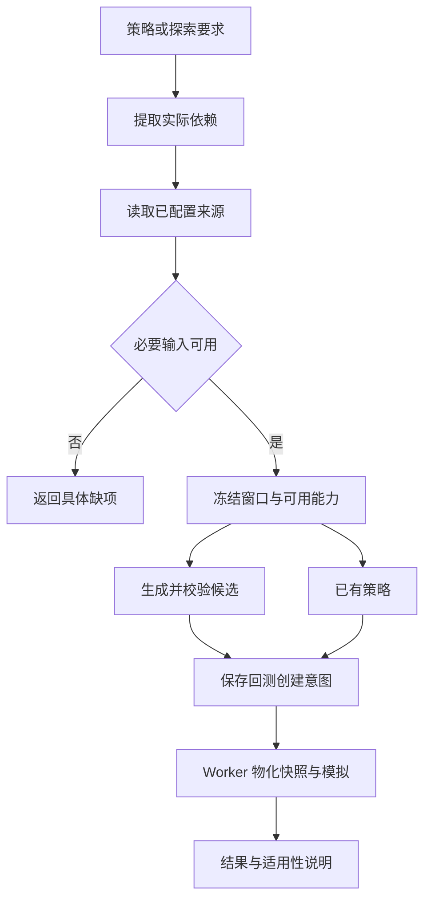

# 策略回测按现有数据运行的详细设计

日期：2026-11-20。状态：现行行为合同。核心实现见[实施任务](../archive/tasks/2026-11-20-backtest-practical-design.md)，最终V6同版本七例完整通过，见[归档任务](../archive/tasks/2026-11-21-backtest-final-seven-recheck.md)及[本批证据](../evidence/2026-11-22-backtest-comparison-readback-recheck.md)。原问题与历史判断见[整体审查](../archive/reviews/2026-11-20-backtest-design-review.md)。

本方案将现有数据支撑的常用策略作为交付中心，明确输入依赖、可选能力、生成与执行合同、结果口径、任务恢复和版本兼容。新增合同按配套Task逐项实施，目标运行态以实际验收为准；未完成的合同不能视为当前产品已经可用。执行状态只在配套 Task 维护。

## 一 目标与本期范围

让用户用当前已配置来源完成单标的价格策略研究，并能理解某条规则、某次操作为什么未执行。尽量在准备和生成阶段发现问题，减少进入 Worker 后才失败、反复修改同一症状的情况。

本期覆盖普通股票／ETF 研究及 AI 探索的共同路径；分析口径和引擎身份修复同时覆盖已有 NAV 路径。后复权价格、研究单位、按金额／比例投入和研究费用继续使用现有模型。原价仅为实际价格规则与固定份数投入提供参考。[S1]

### 本期决策

| 主题 | 决策 | 直接效果 |
| --- | --- | --- |
| 必需输入 | 从规则、保护、仓位和执行模型联合推导 | 不因策略未使用的量额或原价缺失而统一失败 |
| 探索范围 | 根据本次取得的数据冻结可用能力 | 只有后复权也能进行纯指标探索 |
| 缺量研究 | 新日级证据协议允许“价格已观察、成交量未知” | 普通价格研究可以消费；不冒充真实成交资格 |
| 分钟与小时 | 本期保留已有一分钟聚合，展示实际可用窗口 | 不把原生小时线接入作为日线改进的前置 |
| 换手指标 | 实际成交额除以初始研究资金，明确双边、区间口径 | 不新增数据需求，避免金额直接参与比例评分 |
| 结果可用性 | 按规则、操作和优化目标分别判断 | 局部缺值或无关指标未定义不否定整个结果 |
| 生成合同 | AST 与来源由模型决定，重复字段集合由确定性编译派生 | 去掉重复维护，同时保留交易意图 |
| 入场政策 | 新策略显式保存；旧策略按原路径解释 | 增加止损不再隐式改变重入场逻辑 |
| 任务生命周期 | 复用 BacktestJob，创建先落库，Worker 物化快照并执行 | 创建阶段可查询，取消意图可持续传递 |

本期不新建全市场数据平台、完整公司行动库、历史费率库、严格 PIT、历史股票池、跨资产组合或通用工作流引擎。原生小时线、订单级硬终止和复杂实际份额计费见第十一节；这些能力不承担普通日线研究的完成条件。

## 二 数据到底够不够用

### 2.1 从实际用途提取依赖

准备器复用现有 AST 与价格规划，联合读取 entry、exit、保护规则、委托价格、仓位模式、估值与撮合方式。不能只扫描入场表达式。例如策略未使用成交量，但执行模型使用成交量参与率时，量仍属于必需输入。

| 用途 | 必要输入 | 不应附加的共同要求 |
| --- | --- | --- |
| MA、RSI、MACD 等日线规则 | 算子实际使用的后复权价格、预热、日历 | 原价、完整分红事件、成交额 |
| 下一开盘模拟买卖 | 对应操作时点开盘价、研究资金与费用模型 | 逐笔成交、订单簿 |
| 高低点突破、ATR、日线触价 | 算子或撮合政策需要的 OHLC | 未使用的量额 |
| 实际价格阈值、原价指标 | 对应原价字段和预热 | 与后复权强制同源、通用复权因子 |
| 固定份数投入 | 操作时点原价，用于将参考份数换算成投入金额 | 恢复全程真实股数及现金分红到账 |
| VWAP、量能过滤、参与率 | 所需量额、适用单位及盘中窗口 | 与该算子无关的其他字段 |
| 月末、会话、跨周期规则 | 对应交易日历、周期、完成及可见时点 | 所有市场全部历史数据 |

“按需”是取消额外业务前置。现有来源仍返回标准 OHLC Bar，本期不把所有字段都改成可空，也不重写所有行情接口。

### 2.2 内部依赖计划

在现有价格计划上增加必要的用途信息，避免建立平行规划器。建议的语义形状如下，具体类型归 Schemas／Domain 所有：

```ts
type ResearchInputNeed = {
  sourceId: string;
  coordinate: 'research' | 'actual';
  timeframe: string;
  fields: string[];
  minimumWarmupRows: number;
  necessity: 'required' | 'optional';
  consumers: Array<{
    kind: 'rule' | 'sizing' | 'execution' | 'valuation';
    path: string;
  }>;
};
```

同一物理来源、周期和价格坐标合并取数，预热取各用途的最大需求；同一输入被任何必需用途引用，就升级为 required。不同坐标或周期保持独立。字段单位要求由算子决定：实际金额阈值、按股参与率需要明确单位；不能因另一个算子要求严格单位就提高所有价格规则的要求。

### 2.3 必需与可选的具体判定

- 普通已保存策略、用户选定的实验基线、用户明确指定的条件与投入方式，其依赖均为 required。
- 从零探索为了扩展候选范围而预留的原价、量能或额外周期为 optional。若用户明确要求探索某项能力，其依赖成为 required。
- 可选原价只访问已配置并适用的路由，沿用现有分页、超时与主备预算；没有配置就立即记录能力不可用，不扫描所有 Provider。
- 两套价格独立选源。原价失败不重取已经成功的后复权，不为寻找同源整体重试。
- 只将结构化的缺窗口、权限不足、未配置或暂不可用转成可选能力限制。错误标的、错误币种、内容摘要冲突、解析程序错误仍按对应错误处理，不能用 catch all 吞掉。
- 用户日期不被自动裁短。可以展示实际可取得范围，用户修改区间后形成新准备输入。

准备请求的priceResearchReference省略时只取得实际依赖；freeze表示明确要求额外原价窗口，optional表示探索预留。optional在策略已引用原价条件或固定份数时升级为必需，不能降级用户规则。新从零探索在未指定时采用optional，既有明确freeze请求仍按必需解释。可选读取失败的结构化原因写入dataScope.unavailableCapabilities，不写入不存在的窗口身份；错误响应、窗口／标的／来源不一致和摘要冲突仍阻断。

## 三 准备成功与数据能力

### 3.1 复用已有准备状态

仍使用 prepared、blocked、preparing。可选能力缺失返回 prepared，并附具体能力范围；不新增一套“部分就绪”状态机。preparing 继续表示已有异步资料准备，不能用来掩盖永久不支持。[S2]

在准备结果及新研究配置中保存最小 dataScope，窗口引用继续使用现有 priceResearch／来源结构：

```ts
dataScope: {
  version: 1,
  executionInstrument: { symbol: '159516.SZ', market: 'CN', assetType: 'etf' },
  priceCoordinates: ['research'],
  sources: [{
    sourceId: 'main',
    coordinate: 'research',
    timeframe: '1d',
    fields: ['open', 'high', 'low', 'close'],
    warmupRows: 60,
    observedRows: 80,
    volumeBasis: 'unknown',
    fieldWindows: [
      { field: 'open', validRows: 80, warmupRows: 60, longestWindowRows: 80 },
      { field: 'high', validRows: 80, warmupRows: 60, longestWindowRows: 80 },
      { field: 'low', validRows: 80, warmupRows: 60, longestWindowRows: 80 },
      { field: 'close', validRows: 80, warmupRows: 60, longestWindowRows: 80 }
    ]
  }],
  sizingModes: ['fixedAmount', 'equityRatio'],
  unavailableCapabilities: [{
    capability: 'actual-price',
    code: 'missing_window'
  }]
}
```

上面是“只有后复权”的例子，不是所有研究的固定 60 根预热。实际值从本次准备与已保存预算产生。dataScope 不保存重复行情，也不把“有这个字段”解释为每个时点都有值；具体缺值保留在冻结输入与结果诊断中。

能力的最低判定明确为：字段在整个窗口都没有有效值时不开放；只有一根有效值不能因此开放需要20根输入的算子。复用已有预热规划，将实际可用输入和预热预算传给生成器，并在候选编译后检查其具体窗口需求。已知必需输入整窗为空、或没有任何窗口能满足必要预热时，在准备阶段指出；依赖持仓、事件等运行状态才能判断的可计算性留给执行诊断。局部缺口不采用统一覆盖率淘汰。

dataScope绑定唯一executionInstrument，每个来源记录明确价格坐标、逻辑周期、可用字段和字段窗口统计（有效观测数、预热有效数、最长连续有效窗口），不保存行情值。统计使用现有逻辑来源序列构建，小时来源继续按实际日历从一分钟聚合，不能把一分钟行数直接宣称为小时观测数。字段摘要用于约束生成；具体候选再按已有冻结输入核对其组合和嵌套窗口需求，不把不同时间段各自出现过的有效字段当作同一窗口已满足。窗口内的缺值仍保持原观测位置。

已保存dataScope与冻结父窗口引用的新研究配置，累计锚点可以早于候选自身指标算出的较短预热起点。规划只生成覆盖该锚点的子窗口，随后必须由同一冻结父窗口验证其真实覆盖；不能把“早于候选默认起点”等同于“早于已取得的父窗口”。父窗口未覆盖仍按原规则拒绝，不转为新行情获取；算子所需预热根数超过冻结预算仍拒绝。没有本次dataScope的旧配置保留原解释，已成功的旧计划与结果不改写。

准备阶段显式预留候选预算时，所有实际规划并冻结的物理周期使用同一个acquisitionPlan起点，额外周期不能只按种子策略的短预热获取，否则主源已有锚点窗口而额外源无法物化同一全局窗口。dataScope仍按各逻辑周期实际数据统计。旧父窗中某个周期确实不足时保持拒绝，不在候选执行时补数据；扩大的范围只能来自新的准备，旧失败与新准备上的诊断重放分别记录。

聚合能力统计的日历也覆盖实际acquisitionPlan窗口，准备端把对应日历依赖计划传给既有读取端口；不能用种子策略的较短计划给已取得的较长分钟数据做聚合证明。该准备编排由既有数据范围模块承载，不改变分析日期、冻结输出合同或旧快照中的日历事实。

额外周期的冻结引用缺失、不可用或校验不符属于稳定输入错误，使用既有DATA_UNAVAILABLE进入终态，不自动重算；读取端直接抛出的未分类基础设施异常仍保留原分类，不把它伪装成输入缺失。

### 3.2 准备结果如何约束生成与执行

1. Market 读取并冻结实际窗口，Backtest 根据所得字段、坐标和周期确定 dataScope。
2. dataScope、窗口引用、运行假设、策略／探索空间版本一起进入准备身份和实验比较指纹。
3. AI 生成器只看到本次可用能力和用户要求。正式编译、保存、创建、Worker 再按同一个合同检查。
4. 模型生成范围外条件时，在创建前返回具体路径与能力缺项；不能临时补行情或自动删掉条件。
5. 数据能力改变后重新准备并创建新的研究／实验身份。进行中的实验、基线和候选不偷偷升级输入。



准备时的 Market 窗口冻结与 Worker 的物理快照物化是两个步骤。后者只组装已确定的研究输入，不能借异步化重新选源或扩大窗口。

### 3.3 新旧实验的范围

新探索空间采用 strategy-space-price-research-v2，允许后复权单输入并要求 dataScope。当前旧实验版本继续要求原双窗口，克隆、重试、历史读取按其版本解释。新规则先增加兼容读取，再启用新写入；不删除旧实验的原价要求来冒充兼容。[S2]

## 四 缺少成交量的价格研究

### 4.1 为什么要改两端合同

当前 DSA 组装日级证据时要求正成交量，将有 Bar 的日期标为 observed-traded；Server 的 Schema 又做同样检查。只删除 Server 的判断，DSA 仍然拒绝；只放行 DSA，消费侧和冻结重放仍会失败。[S3]

### 4.2 新日级证据版本

保留现有日级证据 contractVersion = 1 的含义。新增版本 2，增加 observed-price-only 状态，表示价格有效、成交量未知。

| 输入事实 | 新研究模式处理 |
| --- | --- |
| 有效 OHLC，成交量为正 | 继续 observed-traded |
| 有效 OHLC，成交量缺失 | observed-price-only；允许价格条件和不依赖量的研究撮合 |
| 缺 Bar | 沿用明确缺日政策，不合成价格或成交 |
| 真实零量 | 保留既有零量来源投影／排除规则，不转换为 price-only |
| 负量、非有限数值、OHLC 关系错误或日期冲突 | 返回具体输入错误 |
| VWAP 或参与率所需量缺失 | 相关求值或操作不可用；不把未知量补为零 |

版本 2 只用于显式固定快照价格研究，不授予真实份额、严格历史状态或其他业务资格。price-only 日的模拟操作明确来自研究假设；若执行模型需要量、真实整手或其他未提供事实，不能沿用这个放行条件。

请求新增 dailyObservationVersion: 1 | 2，响应日级证据的 contractVersion 必须匹配。版本进入窗口、缓存和冻结身份，旧缺省请求继续选择版本 1。版本2的 observed-price-only 只对应 volume=null，已有有效数值不改写成缺失。DSA 先具备兼容声明与双版本响应能力，Server 再启用版本 2 请求；不能由 Server 为旧来源响应补出一个版本 2。

部署先更新消费端兼容读取，再更新DSA生产与声明。新准备在读取行情前核对服务能力：已声明版本2时显式选择2；未声明时保留既有缺省版本1请求，并在新运行配置记录实际采用的版本1。能力读取失败时阻断，不猜测支持、不在失败后换版本重试。旧服务不会收到新字段，新准备仍可使用原来足够的正量价格输入；已有冻结配置及在途实验不随服务升级改版本。服务支持2后，后续新准备自然选择2，不转换旧证据。

沿用一分钟聚合的新版价格研究，也按实际字段处理未知量：任一成分量未知时，聚合量保持未知；成交额字段缺失不在新研究聚合中用价格乘成交量补造。价格与会话完整性仍独立核验，不补零、不把分钟数量当成小时观测数。该行为由新研究读取显式选择，旧读取保留原必填量及聚合解释；不增加原生小时线接入前置。

修改范围包括 TS 的日级证据、请求响应相关校验、研究读取选项、快照可交易性投影，以及 DSA 的日级证据生产与市场适配。旧快照按旧解码器离线读取，新快照保留真实的量缺失值。[S3]

## 五 缺失的局部影响和结果资格

### 5.1 统一处理表

| 情况 | 处理与用户结果 |
| --- | --- |
| 可选原价整窗不可用 | 纯指标探索 prepared；显示本次未开放实际价格条件 |
| 用户规则必需原价整窗不可用 | blocked，指出规则路径、字段、来源与窗口 |
| 原价只有个别时点缺值 | 对应条件 unavailable；其他规则按既有布尔求值处理 |
| 固定份数操作时点缺原价 | 该次操作未执行，记录原因；不自动改为金额投入 |
| 普通恒假规则 | 正常零交易结果 |
| 退出规则在全程空仓下从未适用 | 不记为数据缺失 |
| 关键规则在所有适用时点都不可计算 | 结果保留诊断，该策略本次不可评价 |
| Sharpe 因零波动未定义 | Sharpe 单项不可用；收益／回撤目标仍可评价 |
| 账本不守恒、负数量等执行错误 | 运行失败，不能归为可选输入缺失 |

必需原价的取得窗口整体不可用时，准备诊断从实际依赖列出规则或操作路径及其所需字段，使用独立原价路由及实际请求窗口（含预热）。原价失败原因保留在诊断中。单独指定冻结原价但没有引用原价的规则时，提示原价窗口不可用即可。

不设统一“数据必须达到 100%”门槛，也不新增任意的 95% 覆盖门槛。缺失按用途与发生时点处理；实验已有最少交易数等要求作为目标约束单独检查。未成交、未触发和不能计算是三种不同情况。

### 5.2 有界诊断

每条规则记录 ruleId、观测次数、可计算次数、成立次数、实际适用的决策次数、按原因汇总的不可用次数。每个原因最多保存 3 个路径／时点样本，避免保存每根 Bar 的整棵 AST。

条件观测和下单资格分开：入场条件沿策略决策时钟观测并维护边沿，空仓、资金与待执行订单决定当前能否发出委托；不能在持仓时停掉边沿记忆。诊断另外统计有入场资格的时点。退出按持仓阶段、保护按激活阶段统计适用次数，预热单独统计。布尔短路已能确定 false 或 true 时，结果仍可计算；未执行的分支不虚增不可用次数。

三值组合明确为：all遇到可见false即可为false，any遇到可见true即可为true；只有没有决定性分支且必要分支缺值时才返回unavailable。诊断以正式入场、退出、风险及保护启用规则为根，记录该根实际求值结果；不会为已短路的内部子树虚构额外失败。不可用原因使用稳定代码分组，每组最多三个路径／时点样本，不复制整棵AST。

开发／验证的模型反馈只投影规则计数与原因汇总，时点样本保留在正式结果中，不重复进入模型上下文。封存测试的诊断与指标一样不提供给生成器。

暂缺输入不把条件记为 false，也不重置边沿记忆；首次可计算的值与后续恢复继续按明确的 entryTrigger 合同处理。历史窗口与预热仍采用算子现行定义，本期不借诊断改写窗口语义。

### 5.3 优化目标按依赖判断

| 优化目标 | 必需指标 |
| --- | --- |
| 收益 | totalReturn |
| 回撤 | maxDrawdown |
| 低换手 | turnoverRate |
| balanced | totalReturn、maxDrawdown、turnoverRate |

显式硬约束再补充对应指标依赖。去掉以全局 completeness = complete 作为所有目标前提的逻辑；保留来源、账本和关键规则失败的具体原因。零交易可以显示；若实验要求至少一笔闭合交易，则归为“未达到实验目标”，不能叫“数据不足”。比较继续使用同一冻结窗口、费用假设和版本，缺失影响计数跟随候选结果展示。[S4]

## 六 表达式和 AI 生成

### 6.1 先解决遍历不一致

新增有类型的 expressionChildren(node)，使用穷尽分支约束。首先迁移会话序列收集，覆盖 arithmetic、absolute 等合法嵌套；再按需要迁移其他依赖消费者。

统一正式规则根清单，覆盖当前允许的入场、退出、保护、委托价格等位置。子节点遍历只描述结构；历史窗口是否允许动态会话值、事件能否嵌套等仍由语义校验负责。不能为了消除漏遍历顺便放开原先不合法的组合。[S5]

会话VWAP继承其来源价格的市场与价格坐标单位，与同源close可相减；elapsedMinutes仍为时间单位。Schema与运行兼容分析采用同一单位含义，不能把会话价格错误编码成独立sourceId单位而拒绝合法价差。不同价格坐标或时间／价格混算仍按原约束拒绝。

### 6.2 新生成协议

模型继续决定交易 AST、逻辑来源及周期、比较方向、capture 和 lag。重复的 series 字段集合改为编译派生值：从模型明确引用的 AST 与已声明来源计算依赖，再装配到正式策略。

编译允许派生字段集合、用途与预热需求，不能新增来源、改周期、补 capture、增删 lag 或改写阈值。原始模型输出、编译版本、正式配置和诊断分开保留。旧输出仅可标为在新编译器下兼容，不能回写成旧模型首次成功。

新用途版本确定为authoring-generation-v6、authoring-modification-v6、strategy-discovery-v6，编译版本为strategy-ast-compiler-v1；旧v5及更早合同继续保留读取。新生成中的来源声明包含id、周期和价格坐标，编写入口还包含已确认资产；探索入口的唯一下单资产由冻结范围装配，全部逻辑来源仍由模型明确声明。来源声明不再携带series，程序从实际AST和隐式保护依赖派生。未使用的声明保留且series为空，不补close、不删除来源；没有市场信号依赖时允许V3逻辑来源列表为空，执行与估值仍依赖已有独立物理输入。主周期继续决定执行时钟，不强制增加一个未被规则使用的主周期逻辑来源。V2保留原非空及主周期来源要求。

每次新编写操作保存生成合同引用，结果保存原始生成JSON及独立编译产物／诊断，应用或审核时按所保存的合同解释。历史操作不补写编译成功，旧模型计数不改。探索同样在已有步骤JSON中分别保存接收输出、编译版本与正式候选，不增加任务表或第二套执行流水线。只有全部正式校验和本次dataScope约束通过的编译产物可以进入保存／创建。

V6接收已完成但结构校验失败时，也保留现有输出字节上限内的原始文本与结构诊断，不能只保留String(error)。SDK仅为这三个新用途在完成事实中携带原始文本；旧用途不增加字段。编写继续保存于已有outcome，探索保存在当前AiRun的modelMetadata，写入受原执行attempt和非终态归属限制。超过原输出上限按已有超限规则失败，不为了留存放宽业务输出上限。

V6正式探索在原生Schema模式下也通过现有`buildGenerationSchemaPrompt`向模型显式提供同一份完整结构合同，且在输入估算和预算预留之前装配。原生响应格式仍承担约束输出结构的职责；不能假设下游会把其中的Schema自动作为模型可见的字段说明。用途资格、编写与正式探索不得仅靠合同名称推断AST字段。此补充只改变新空间的提示版本，不改V6／V5字段合同、旧提示的交易含义、旧回执或调用预算；修复后真实业务效果必须单列复验，不能用离线提示检查冒称已通过。

模型可见的完整结构合同可复用现有`buildDiscoveryTextSchemaPrompt`表示为紧凑YAML；断言、引用、必填字段与边界必须和原JSON表示等价，原生输出Schema、用途版本及私有资格指纹不变，消息仍按实际字节预留。V6两种入口共享领域算子说明：同时过滤使用all，窗口计数／连续确认不附送事件sequence，动态持仓资格放历史窗口之外；A不高于B明确为left=A、lte、right=B；冻结某个触发操作数保留其完整lag；会话累计VWAP用sessionValue.vwap，与任意固定窗口VWAP（包括period=1）区分；当前已完成可见值不额外后移。空仓资格不隐式授权while-flat；比例原值与中文百分比一致。说明只帮助模型选择，接收端仍不能替模型改AST。每个确有实现变化的新提示版本分别做有界业务验收，原失败输入不原样自动重发，原回执和版本分别保留。

V6布尔联合的展示顺序采用普通组合与比较在前、连续窗口随后、事件sequence在后，不把复杂事件作为所有普通条件的首个模板。该变化只能置换既有联合分支，不增删字段、范围或事件绑定；需与前版实际原生Schema递归核对结构等价（忽略分支顺序、引用名称和说明注解），并保留旧V5原生摘要。用途版本、路由及资格指纹保持，不能借展示调整扩大合格能力，也不能据此改写已生成AST。新序列化对应独立提示版本和单次业务验收，是否改善模型选择以真实回执为准。

V6完整Schema之后保留简短的生成末次核对：冻结触发比较的某个操作数时，capture与该完整操作数逐层相同，不能仅取其input而丢掉lag或其他运算；repeat=true允许确认完成后的后续新事件再次启动，repeat=false表示全历史成功确认一次后不再启动。“每轮首次确认”与“结束后可重新启动”同时出现时仍选true，不能把前者误解为全历史一次；allowSameBar独立决定同根确认。固定保护的退出阈值不同时表示额外启用条件，无独立启用要求时模型显式选择activation.immediate；仅另有延迟要求时选择相应条件启用。说明描述实际即时保护，不得称省略了实际存在的字段；涉及字段形状时与最终JSON逐项一致。该核对仅给模型提供明确区分，不由程序推断自然语言、复制AST或删除模型附加条件。未正确保持时记录业务失败，即使技术校验／执行通过也不计为原意通过。

上述末次核对对窗口与时钟使用明确字段映射：最近N根至少K根成立为compare(countTrue(periods=N,condition),gte,K)，连续M根为consecutive；同刻过滤使用all，sequence的事件确认值不能替代计数。指标周期只写params.period，标准差除均线的分母为完整MA数值表达式，分位数窗口输入复用完整比值，不能用周期常量冒充指标结果。最新已完成小时值及均线直接使用小时来源当前表达式；仅前一日累计值的lag作用于日线累计表达式。anchorAt由模型写完整ISO时点及明确时区，说明提供带偏移的格式示例，但不从自然语言替模型补时区。示例不改变本次数据能力或用户参数，原Schema和私有资格合同保持。

七例业务验收使用独立于模型reason的明确需求断言，在正式创建前检查本轮AST。断言属于受控验收，不是生产自然语言解析器；生产代码不得按七个样本ID生成或修补策略。验收先零模型调用证明：正确配置通过，参数变体和已列明等价表达不误拒，空仓取反、周期替代指标值、额外lag、丢失capture／事件引用、错误repeat及锚点时区能被识别。等价范围明确限定为合取顺序、十进制表示、相反比较方向、均值的sum／周期写法、同一锚点时刻及来源重命名，不宣称通用表达式等价求解。未识别的表达不能猜测通过。

生成端V6说明与旧说明分开维护，使用单一语义说明及类型正确、可经正式生成Schema解析的完整算子示例，减少多份重复说明和不可解析的伪JSON。明确空仓为not(isOpen)，当前已完成值不再lag，冻结比较操作数必须显式capture及eventValue，说明按实际AST读取；示例是语法参考而非本次策略，参数、来源与逻辑继续由模型按用户需求生成。完整Schema、用途版本、原路由及私有资格边界保持。七例最终验收必须同一修复版本各一次，原意、说明、创建和冻结执行全部通过才完成；拒绝更准确不等于生成修复成功。

事件在普通布尔组合之后展示，其已有有capture／无capture两个分支中先展示完整捕获分支，减少冻结需求误选无捕获形状。仅置换既有联合分支，不增删合法字段或绑定；继续与原V6原生Schema做递归结构等价核对，旧V5 Schema保持。不能通过强制添加capture或放宽绑定来通过验收。

V6编写与局部修改按定义的可选根字段是否存在装配本次Schema。每个分支的需求引用只枚举该分支实际存在的根字段；存在的可选字段仍可引用。输出先生成定义，再映射需求覆盖，最后根据实际定义回读。继续使用同一外层字段、正式覆盖校验与冻结修改范围；此约束提前拒绝原正式校验已拒绝的关联，不扩大或缩小可正式采纳的交易定义。通用资格Schema、用途引用、原路由及历史结果的读取方式保持。

生成说明以同一合取中的成对比较展示边界：“不高于”用lte，等值通过；“小于”用lt，等值不通过，无需原文另加“严格”。固定止损用成对计划区分建仓即生效和另行指定的延迟启用；首笔成交价跌幅是保护开始后触发退出的门槛。首笔成交价与持仓均价是独立事实。普通市价按输出定义主周期的下一可交易根开盘回读；分钟策略可以在盘中成交，不默认跨日。生成说明不改写用户原话或模型产物。编写时，明确当前修改目标和已确认执行时钟，保留范围外冻结规则；仅修改计划时优先呈现该计划的语义，减少无关算子示例。

V6探索按冻结来源中的周期与字段选择参考示例，仍提供完整生成Schema和来源范围。此选择只影响参考内容，合法表达继续以正式合同及本次数据能力校验为准。普通退出明确永不触发时，示例使用两个不同常量的等值比较，不读取行情或持仓。百分比相对偏离按现值除以参考值再减一，按需取绝对值；价格差保留货币量纲。此前N根窗口不含作出判断的本根，含当根的滚动算子通过对完整结果lag(1)表达此前窗口，冻结比较操作数时捕获该完整结果。三个示例分别给出一步步可核对的操作数，继续由模型决定本次来源、周期和参数。初始保护的退出说明明确收盘达到或低于保护线（含等值）时触发。

大小比较的模型回读优先用数学符号或对应比较词，复用程序的“高于／不低于／低于／不高于”口径。连续窗口逐根满足大小比较时，说明保留“每根”与实际比较方向。“上穿／下穿”用于有前根与当前关系的交叉，单根或逐根大小比较不称为穿越。正常编写中，未明确依赖原价的指标、会话累计及比例偏离使用研究坐标；K线周期与价格坐标独立。只有用户明确指定原价，或规则的实际价格条件依赖原价时选择实际坐标。份数计算所需的原价参考不要求改变指标的坐标。该选择由模型作出；正式准备和执行按原能力范围校验，不更换已输出来源。字段注解只表达这两项现有语义，不增删用途字段、合法分支、资格规则或数值断言。

生成流程固定为：

1. 根结构解析；结构不成立时返回结构错误。
2. 编译合法结构上的机械依赖。
3. 汇总可独立判断的来源、能力、坐标、事件绑定、时点和预热错误。
4. 全部必要约束通过后形成候选，再进入保存或回测。

诊断使用稳定的 stage、code、path、message、details；路径错误不再全部压缩为 String(error)。某个来源未声明时，报告受影响路径，但继续检查不依赖该来源的事件绑定等独立问题。

### 6.3 事件与多周期语义

事件分支区分无 capture 和有 capture；仅有绑定的作用域允许 eventValue。生成 Schema 尽量限制非法组合，正式语义校验仍检查引用目标与作用域。无绑定时返回错误，不自动猜测模型要捕获什么。

模型上下文明示：运行时的当前值已是该周期在决策时刻完成且可见的最新值；lag(1) 表示再往前一根。锚点必须带时区，回读展示对应市场时间。不能通过服务端自动去掉 lag 或补时区来纠正意图。

生成用途采用新的合同版本，旧版本继续可读。当前所有有效来源、预算和人工确认机制复用；不增加失败后无限生成或自动修复循环。真实模型验收在离线固定样本通过后，按单独确定的固定版本和有界调用计划进行。隔离测试等待必须覆盖已授权调用各自的期限之和及准备开销；普通隔离测试继续原等待上限，仅明确指定的十次V6模型批次允许55分钟等待。超时先停止本次创建的测试进程组，再清理隔离数据库，不能只结束pnpm父进程而让子进程继续调用。已收到的原始回执可在新隔离库零模型调用重放，保留首次基础设施失败。[S6]

## 七 成交指标与入场政策

### 7.1 成交额与区间双边资金周转率

本期采用一个不增加行情需求的明确口径：

\[
\text{tradedNotional}=\sum_{f\in\text{实际成交}}|q_f p_f|,
\qquad
\text{turnoverRate}=\frac{\text{tradedNotional}}{C_0}.
\]

C0 直接取 runConfig 的初始研究资金，不能取权益曲线首点，因为它可能已经是首日收盘估值。界面名称使用“区间双边资金周转率”；1 显示 100%，不年化、不时间加权。

金额统一为运行基准币种。不同币种的成交使用成交时点可见的冻结汇率；初始现金篮子使用运行开始日00:00 UTC时可见的冻结汇率折算，不随策略首次成交日期改变分母。复用现有估值汇率选择及失效规则；缺少必要汇率时仅相关金额／周转率不可用，不混加币种或临时新增来源请求。

- 买入、部分卖出、期末未平仓成交全部计入。费用、分红现金和拆股记账不计入成交额。
- 后复权研究按研究单位乘成交价计算；NAV 只计已确认形成的成交，待确认申赎申请不计入。
- 初始资金为正且无成交，周转率为 0。未来引入外部追加／抽回资金时另定义版本，不静默沿用。
- 初始 1,000、买入成交 1,000、部分卖出 500，成交额为 1,500，周转率为 150%。
- 相同比例策略在资金、成交和固定费用一起同比缩放，或仅使用比例费用时，归一化指标保持一致。固定最低费用未同比缩放时，收益差异可能来自费用，不能错误断言所有资金规模的收益必须相同。

新增 research-analytics-v2，输出 tradedNotional 和 turnoverRate；新 balanced 评分为 totalReturn − abs(maxDrawdown) − 0.05 × turnoverRate。其他已有目标按其保存的权重处理。

新版评价摘要保存scoreVersion=optimization-score-v2和analyticsVersion。新版实验比较身份包含原冻结数据指纹、分析版本、评分版本与完整Runner身份；旧无版本结果沿原金额算法读取和比较，不把新旧评分混排。股票／NAV的分析变化各自提升Runner版本，历史结果不重算。

新评分不再把旧 turnover 当作 turnoverRate 的别名。旧结果缺少新版本时按旧金额语义展示，旧实验分数保留；新旧分析版本不直接混排。若需要按新算法比较旧输入，创建新的分析／运行身份，原结果与摘要不改。[S4]

### 7.2 入场政策

新增 entryTrigger：rising-edge 或 while-flat。新策略默认 rising-edge；while-flat 仍须满足空仓、无冲突待执行入场订单和其他既有生命周期条件。

旧策略无字段时，按原行为解释：普通路径为 rising-edge，已有有效 tradePlan 路径为 while-flat。编辑旧策略时先将原政策物化到新版本；仅加保护保持该政策，界面和中文回读展示变化。

全新策略未指定时在新建边界保存rising-edge；编辑器载入旧定义后先物化其原政策，再修改保护或其他规则。正式新版本发布必须已含entryTrigger，缺失时具体拒绝并要求核对入场政策，不能依据修改后的tradePlan反推旧政策。历史读取及幂等已存在版本不走新写入默认值。

NAV存在待处理申赎时，新政策继续推进entry观测记忆；退出仍服从原有申赎串行协调，不能因推进入场记忆提前消费尚不能提交的赎回边沿。现金不足或待执行入场不把入场条件改为false，也不保留一个虚构的新边沿等待资金恢复。

显式政策的条件观测沿策略决策时钟推进，持仓和待执行订单只影响委托资格。首次可计算真值为 true 时允许形成初始边沿；之后 false → true 才形成新边沿，已经发生但当时没有下单资格的边沿不排队到以后执行。缺值不制造 false，也不重置已经为 true 的状态。

旧版本继续原执行解释与结果。新显式政策实现需要用旧路径成对固定观测时点，编辑旧策略时不能仅补字段就宣称兼容。必须覆盖“持仓期间变 false，退出后变 true”以及“持仓期间已经再次变 true，退出后持续 true”两种差异，再加退出、拒单和保护结束的重入场样本。[S5]

## 八 创建 取消 重试与恢复

### 8.1 先保存已提交的创建意图

复用 BacktestJob 及现有队列，不增加通用任务表。普通 /prepare 仍是配置准备，不把每次表单预检都变为后台回测任务。本项只移动用户正式提交后的昂贵快照物化。

创建顺序：验证拥有权与请求结构 → 查询幂等键并核对规范化内容 → 已存在则直接返回原 Run → 仅首次创建检查当前准备戳 → 保存 queued 记录及输入 → 投递队列。这样首次建单回执丢失后，即使路由已经变化，同键同内容仍能找回原任务。并发唯一键冲突后也按相同内容核对再返回。Worker 领取后同一 attempt 执行 preparing、freezing、simulating、analyzing 阶段，终态仍为 succeeded、failed、cancelled。[S7]

数据库现有 input、runConfig、snapshot 可空字段与 stage 优先复用。新增的待物化输入带明确结构版本，所有解码入口按状态和结构检查，不能把 snapshot 为空的 queued 记录当已完成冻结输入。

待物化输入采用materialization.version=backtest-job-input-v1，kind为configured或frozen-replay；保存策略摘要，重放另保存已验证的物理来源Run和manifest摘要。NAV保留原inputKind与准备凭证关联。首次创建仅核对已准备的合同与当前控制；不在HTTP请求内编码快照。未装配队列或投递失败仍保留queued意图，等待既有协调器恢复。

物理产物位于现有快照根下按runId／attempt隔离的子目录，产物内部runId和原有manifest／artifact合同不变。发布仅通过带running、attempt和cancelRequestedAt=null条件的数据库更新，同时关联完整manifest与snapshotStorageAttempt；读取与Runner使用该明确存储位置，旧无此字段记录继续原目录。无需在数据库事务中复制文件，也不将多个attempt的产物合并。旧attempt不能更新关联，取消后不能发布。当前attempt及紧邻的前一attempt若存在完整且身份相同的产物，先完整重放后复用；不完整产物只在所属隔离目录重建。完整产物保留以支持发布后进程退出恢复，不删除其他attempt或历史文件。

Worker必须实际装配相同的行情读取、准备守卫、现金原包核验与快照构建依赖。Market将既有回测输入读取组件按模块导出，Server和Worker共同消费；该模块只组装读取组件，不启动目录同步、基金估值定时任务或HTTP队列。禁止为补齐Worker而引入整个应用模块及其后台生命周期。标的走势图等冻结产物消费者也按已发布存储归属读取，不访问实时数据。

### 8.2 幂等与故障处理

| 场景 | 约定行为 |
| --- | --- |
| 同幂等键、同规范化内容重复提交 | 返回同一 Run，不重复构建快照 |
| 同幂等键、不同策略／窗口／能力范围 | 冲突，保留原输入 |
| 落库后队列暂不可用 | 返回可查询的 queued 任务，显示等待执行；按现有15秒协调周期恢复，不切到 HTTP 同步执行 |
| 队列查询异常 | 保持未知，不能推断任务不存在并重复投递 |
| 物化前进程退出 | 重试读取已保存创建意图与冻结窗口 |
| 已写部分文件但尚未生成完成清单时进程退出 | 下一 attempt 从冻结输入完整重建，只发布本次完成的产物 |
| 产物完成但数据库关联失败 | 按 runId、attempt 和 manifest 核对后复用；不拼接半套产物 |
| 旧 attempt 晚到 | 不能发布快照或提交结果，临时产物按归属清理 |
| 已保存准备戳对应路由发生变化 | PREPARATION_STALE，要求重新准备，不自动换源 |
| 终态任务再次取消或重复回执 | 返回已有终态，不覆盖结果 |

当前执行重试每轮最多3次，队列指数退避初始2秒，协调器每15秒检查。队列等待不消耗执行尝试次数，也不伪装为正在计算；用户可以取消。运行失败仍由现有 retryAttemptBase 与总 attempt 约束，不因移入 Worker 增加额度。

必需输入缺失、准备戳过期、协议不符和引擎变化是稳定失败，不用相同输入自动重复计算；基础设施临时错误可在预算内重试。股票创建戳当前没有 NAV 准备凭证的15分钟期限，不为统一接口新增这个期限。已有完整快照的重试走冻结读取；尚未发布快照的首次物化继续遵守准备戳检查。[S7]

### 8.3 取消意图与停止计算

取消针对用户请求的 Run，先原子登记非终态记录的 cancelRequestedAt，不能绑定早先读到的 status／attempt。这样 queued → running 的领取竞态不会丢掉意图。重复取消返回已登记状态。

仍为 queued 时可原子收敛 cancelled；已 running 时由当前 attempt 在停止后确认。成功、失败提交同时检查 attempt 和取消意图，取消后的晚到成功不能写回。

Worker 每约 1 秒检查一次持久取消。同一模拟状态和事件队列支持分批推进：建议每批最多 256 个事件或 20ms 计算预算，批次之间让出事件循环。保留同步包装供纯函数和旧固定样本使用，异步包装只改变调度，不改变事件顺序、Decimal 计算和结果。

准备、冻结、模拟、分析各阶段入口和出口都检查取消。指标预计算、会话序列和结果分析中的长同步循环同样需要有界批次；只改主模拟循环不能保证整体停止目标。短纯函数保持同步，避免无必要地把所有计算都改成异步接口。

CPU 模拟的验收目标是取消登记后 5 秒内释放执行槽位。I/O 阶段传递现有 AbortSignal；不支持中断的下游按现有单次请求期限结束，不声称对所有外部调用都可立即停止。强制终止线程不作为本期基础机制。[S8]

### 8.4 引擎身份

股票与 NAV 各自解析实际 Runner 身份，比较完整身份字符串；领取和手动重试共用判断。首次尚未执行且身份为空可以绑定当前引擎；执行过却身份未知的旧记录不能默认为当前版本。

版本不同时，旧 Run 不原地换引擎。使用冻结输入创建关联的新 Run；旧结果正常读取。分析版本和评分版本也进入比较身份，避免同一历史结果被新算法重新解释。[S8]

领取时发现不同或执行后未知的Runner身份，queued记录稳定失败并保留旧身份／结果；不在后台自动增加新Run。用户显式重试已失败或已成功的旧版本时，以“原Run＋当前完整Runner身份”为幂等键创建关联新Run，返回新id；同身份的已成功Run继续返回原回执。取消记录不因版本变化复活。新Run保存在已有input中的replayOfRunId，物理数据来源另保存已验证的sourceRunId和manifest摘要，两者不混淆。

该关联重放只读取已完整冻结的股票／NAV产物，不访问Provider、不重新准备行情或改变原日期／费用／来源。若没有可信完整快照或已保存的可信重放来源，给出具体缺失并要求重新准备，不能静默取得一套新输入。股票／NAV分别使用实际装配的Runner身份；未装配Runner是明确不可执行，不以占位字符串绑定版本。判断是否执行过同时检查attempt及已有执行时间／结果证据，不能因身份为空就当作首次执行。

## 九 用户界面与错误信息

已有同范围非终态任务的后台轮询不禁用取消。取消命令仍重新核对原Run，并以持久意图与状态／attempt提交约束收敛；查询失败、原操作待确认及已登记取消分别保留其禁用语义。读取尚在进行可继续禁止重试，但不能因慢轮询让取消入口失效。旧查询晚到不能清掉取消时点，终态不能被同attempt的运行中响应覆盖。

两端编写编辑、交易计划回读和提案审核必须能读取V6正式编译后的完整合法AST，包括同标的不同周期；仅调整消费面解析，不改旧操作保存的生成合同，也不使UI替模型补来源、capture、lag或阈值。编辑旧正式版本及恢复可编辑本机草稿时，按来源版本先物化原入场政策；已有待确认保存回执保持原内容，避免破坏回执找回。

准备区域只显示影响操作的内容：可研究的周期和范围、当前限制，以及缺失如何影响规则。例如“可进行日线价格研究；本次未取得原价，暂不生成实际价格阈值和固定份数策略”。详细来源继续复用现有展开区。

用户明确要求的能力缺失时，说明“规则 X 需要原价收盘，所选区间未取得”，并保留输入。若缺的是可选探索能力，开始操作仍可用，不要求用户经过额外确认页面。

任务列表继续使用现有页面，状态旁说明“正在准备快照／正在模拟／正在取消”。结果将收益、回撤、交易次数及曲线放在主要位置，未触发、未执行、不可计算分别统计；研究假设集中简要展示，不在每个指标重复警告。

Desktop 与 Mobile 读取相同 DTO 和指标定义；客户端不自行决定数据足够与否，不从中文错误文本解析状态，不再将成交金额格式化为百分比。所有新增内部值都由共享中文映射展示。

## 十 兼容与交付顺序

### 10.1 版本边界

| 对象 | 新写入 | 历史读取与重试 |
| --- | --- | --- |
| 日级观察证据 | 显式选择版本 2，可含 price-only | 缺省和版本 1 保持原语义与摘要 |
| 实验探索空间 | 新版本携带 dataScope，原价可选 | 旧版本保留双窗口要求 |
| 生成结果 | 新编译协议派生机械依赖 | 原始旧输出保留，不改历史成功统计 |
| 分析与评分 | research-analytics-v2 及对应评分版本 | 旧 turnover 仍是旧金额口径 |
| 入场政策 | 新版本显式 entryTrigger | 缺字段按原路径解释 |
| 待物化任务输入 | 带结构版本，允许 snapshot 尚未存在 | 已冻结旧输入继续原路径 |

版本使用各自领域已有标识与 JSON 扩展，不新建统一版本中心。缺省字段的兼容解码只存在于读取投影，不能补写历史 Artifact 或重新计算旧摘要。

### 10.2 实施顺序

1. 修复有输入仍算错的表达式与分析，加入必要的局部诊断。
2. 先支持后复权单输入的受限探索，再贯通 DSA／Server 的缺量研究合同。
3. 生成编译、事件作用域、能力约束和入场政策统一；两端消费同步。
4. 贯通取消和引擎身份，再将创建后的快照物化移入持久任务。
5. 定向样本通过后做一次受影响构建、隔离 Worker 闭环及代表页面核对；真实来源仅复核必要窗口，模型调用按有界计划进行。

跨 DSA／Server 协议先发布能读旧新两版的消费者，再让生产者接受显式新模式，最后启用新请求。旧版本运行中的任务继续按原输入读取。

关闭新入口可以停止新协议写入，但已生成的新任务仍需兼容读取。回退到完全不识别新协议的镜像前，要先停止新任务接收、处理在途任务并保留兼容读取服务；不能把“关闭开关”当成任意版本都能直接回滚。

仅回退 DSA 时，先暂停接收新准备并处理在途操作，再切换到原版本生产者。兼容的 Server／Worker 保持运行。恢复接收后按 DSA 能力走版本 1，版本 1 和 2 的既有完整快照都仍可离线重放。

## 十一 条件性后续项

### 原生小时线

当前物理规划、请求模式、日级来源证据和冻结路径都绑定 1m／1d；原生 60m 接入需要单独处理来源时间标签、会话边界、完成时点、预热与物理身份。[S9]

当具体小时策略确实受一分钟历史长度／额度限制，而现有来源能提供所需原生窗口时再进入该项。先验证该来源窗口及消费能力，再增加直接读取，保留一分钟聚合为可选输入。数据粒度改变属于新输入身份，不替换进行中实验。

### 实际份额与多笔计费

默认整笔、固定研究费用不等待复杂计费。本期的静态限制针对 raw-events 实际份额、actualShares 券商计费与 perBarCap 部分成交同时启用的受影响组合。异价是未来成交结果，不能作为准备判断条件。T04 的执行兼容检查在运行前指出该组合暂不可用，保留原输入；wholeOrder 及不受影响的研究费用照常通过，不自动替用户更改执行模型。

后续修复采用独立累计接口，消费累计数量、成交额和政策身份；单笔数量乘价格校验只属于 fill 层。订单最低费及平台费作用域要与费率分段共同定义，不能临时拼一个平均价绕过校验。[S10]

### 强制停止失控计算

本期先提供可合作取消和有界 I/O。若真实样本仍无法达到停止目标，再设计由父执行环境管理的硬终止与恢复，避免调用 BullMQ 私有内部接口。现有 attempt 提交约束继续保护晚到结果。

## 十二 验收案例

这些案例验证具体业务后果，不要求为每个字段各写一份重复测试。已保存的冻结样本优先复用，真实请求用于解决尚不能由现有样本回答的问题。

| 编号 | 输入／操作 | 预期 |
| --- | --- | --- |
| AC01 | 纯均线、固定金额、只有后复权 | 普通回测就绪，不请求原价 |
| AC02 | 同样数据从零探索，原价暂不可用 | prepared，候选限制为已有能力 |
| AC03 | 用户明确要求实际价格小于 4 元，原价整窗缺失 | 创建前指出具体规则缺项，不删条件 |
| AC04 | 固定份数，某次操作缺原价 | 该次未执行，有计数；不改投入模式 |
| AC05 | 后复权和原价来自不同已配置来源 | 分别冻结，重放不换源 |
| AC06 | 有效价格、volume=null，新研究版本 | 价格策略可用，量保持未知 |
| AC07 | 相同输入用于 VWAP／参与率 | 只限制依赖量的能力／操作 |
| AC08 | 零量、负量、错日期、错标的 | 沿用对应排除或错误，不因缺量放行规则绕过 |
| AC09 | 生成范围外周期／坐标／字段 | 正式创建前按路径拒绝，Provider 调用数不增加 |
| AC10 | sessionVWAP×1.02、abs(sessionVWAP−close) | 依赖、序列构建和求值一致 |
| AC11 | 同份结构合法输出含多个独立语义错误 | 一次返回可判定错误，不被首错遮蔽 |
| AC12 | 当前已完成小时值与 lag(1) | 两者分别指最新已完成和再前一根 |
| AC13 | 初始1000，买1000、卖500且未平仓 | 成交额1500、周转率1.5 |
| AC14 | 比例策略与费用条件相符，资金同比放大10倍 | 周转率和归一化评分一致 |
| AC15 | 恒定权益、零交易、收益目标 | 收益／回撤／周转率可用，Sharpe 可单项未定义 |
| AC16 | 入场恒假、退出从未适用 | 正常零交易，退出不记数据失败 |
| AC17 | 仅增加止损，含持仓期真值变化、缺值恢复及退出后空仓 | 入场政策保持；观测与下单资格分开；缺值不伪造新边沿 |
| AC18 | NAV 待确认申赎 | 待确认申请不计成交额 |
| AC19 | 取消与 queued→running 领取竞争 | 取消意图不丢，重复取消不改终态 |
| AC20 | 指标准备中及主模拟中的 CPU 大样本取消 | 不提交晚到成功，两种阶段均以5秒内释放槽位为目标 |
| AC21 | 同键并发、回执丢失后路由变化、落库后派发失败 | 同键同内容返回原 Run，不被后来的准备戳变化遮住 |
| AC22 | 快照完成前后退出、旧 attempt 晚到 | 复用完整产物或重建本次产物，不发布半套输入 |
| AC23 | 股票与 NAV 引擎版本变化 | 旧 Run 不原地换引擎，新 Run 保留关联 |
| AC24 | 新旧协议结果及旧实验历史读取 | 原结果、分数与摘要不变，单位显示正确 |
| AC25 | 新快照离线执行；同步／分批模拟对照 | 无新增来源请求，事件顺序和完整结果一致 |
| AC26 | Desktop／Mobile 准备限制、失败恢复、结果页 | 可用操作不被可选缺失禁用，限制和指标中文一致 |
| AC27 | raw-events＋actualShares计费＋perBarCap，对照普通wholeOrder | 受影响组合准备时具体拒绝，普通研究通过，配置不被改写 |

## 十三 代码与现行合同依据

路径相对于主仓根目录。下列来源描述当前实现，新增行为由本方案相应章节定义。

- S1：[双价格研究](2026-11-11-backtest-return-research.md)、[研究默认规则](2026-11-07-backtest-research-defaults.md)、[原价按需读取](../../apps/server/src/backtest/backtest-price-research-input.ts)。
- S2：[现行实验合同](2026-11-11-experiment-price-research.md)、[实验准备](../../apps/server/src/strategy-optimization/optimization-preparation.ts)、[实验研究检查](../../apps/server/src/strategy-optimization/strategy-optimization-research.ts)、[运行准备](../../apps/server/src/backtest/backtest-run-preparation.ts)。
- S3：[行情请求响应](../../packages/schemas/src/market-data-wire-v3.ts)、[日级证据](../../packages/schemas/src/backtest-daily-tradability.ts)、[研究读取选项](../../apps/server/src/backtest/backtest-research-read-options-v3.ts)、[DSA 日级证据](../../../daily-stock-analysis/src/services/thesis_ledger_daily_tradability.py)。
- S4：[结果分析](../../packages/domain/src/backtest-result-analytics.ts)、[实验评分](../../apps/server/src/strategy-optimization/strategy-optimization-evaluation.ts)、[股票执行结果](../../apps/server/src/backtest/backtest-v2-execution-exchange.ts)、[NAV 结果](../../apps/server/src/backtest/backtest-nav-result-v3.ts)。
- S5：[会话序列](../../apps/server/src/backtest/backtest-session-series.ts)、[信号选择](../../packages/domain/src/backtest-signal-selection.ts)、[交易计划运行时](../../packages/domain/src/backtest-trade-plan-runtime.ts)。
- S6：[生成装配](../../apps/server/src/strategy-optimization/strategy-optimization-discovery.ts)、[策略编写合同](2026-11-13-strategy-definition-authoring.md)、[真实失败回执](../evidence/2026-11-20-strategy-expression-seven-recheck.md)。
- S7：[创建生命周期](../../apps/server/src/backtest/backtest-v3-run-lifecycle.ts)、[创建守卫](../../apps/server/src/backtest/backtest-creation-guard.service.ts)、[准备失败任务合同](2026-11-08-backtest-preparation-failure-jobs.md)、[队列配置](../../apps/server/src/backtest/backtest-bull-queue.ts)、[队列协调](../../apps/server/src/backtest/backtest-queue.reconciler.ts)、[执行重试预算](../../apps/server/src/backtest/backtest-retry-budget.ts)。
- S8：[取消意图](../../apps/server/src/backtest/backtest-run-cancellation.ts)、[执行尝试](../../apps/server/src/backtest/backtest-run-attempt.ts)、[模拟循环](../../packages/domain/src/backtest-simulation.ts)、[引擎版本比较](../../apps/server/src/backtest/backtest-indicator-engine-version.ts)。
- S9：[物理周期规划](../../apps/server/src/backtest/backtest-signal-price-plan-v3.ts)、[当前规则能力](2026-11-13-strategy-rule-capabilities.md)。
- S10：[订单费用累计](../../packages/domain/src/backtest-order-charges.ts)、[实际份额计费](../../packages/domain/src/backtest-broker-commission.ts)。
